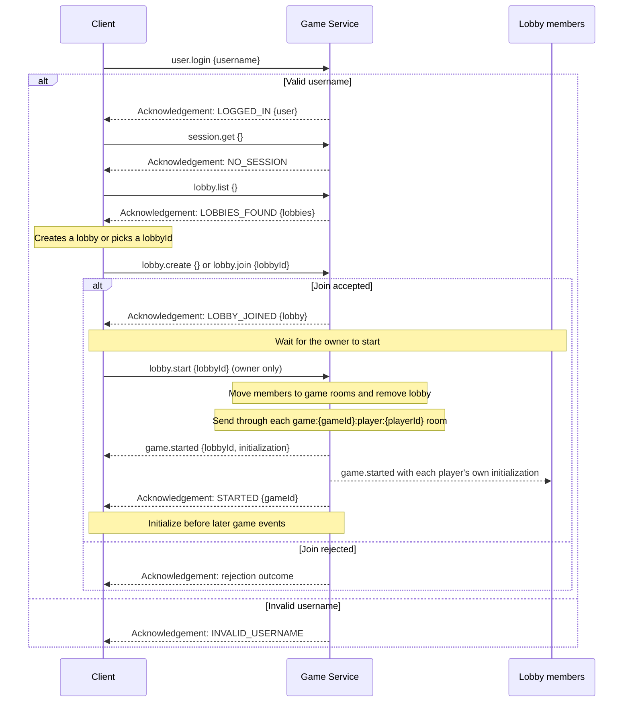
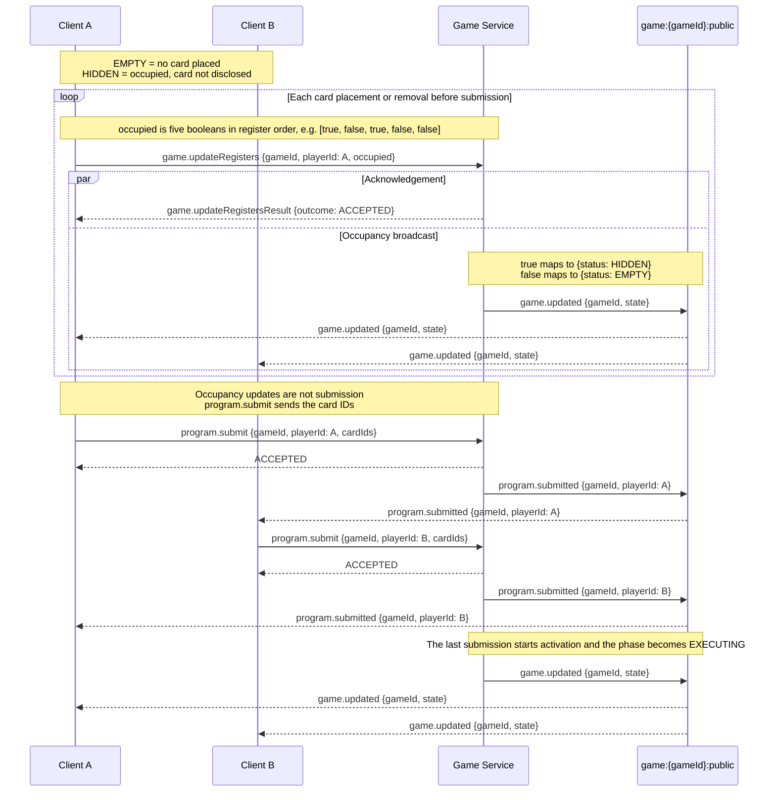
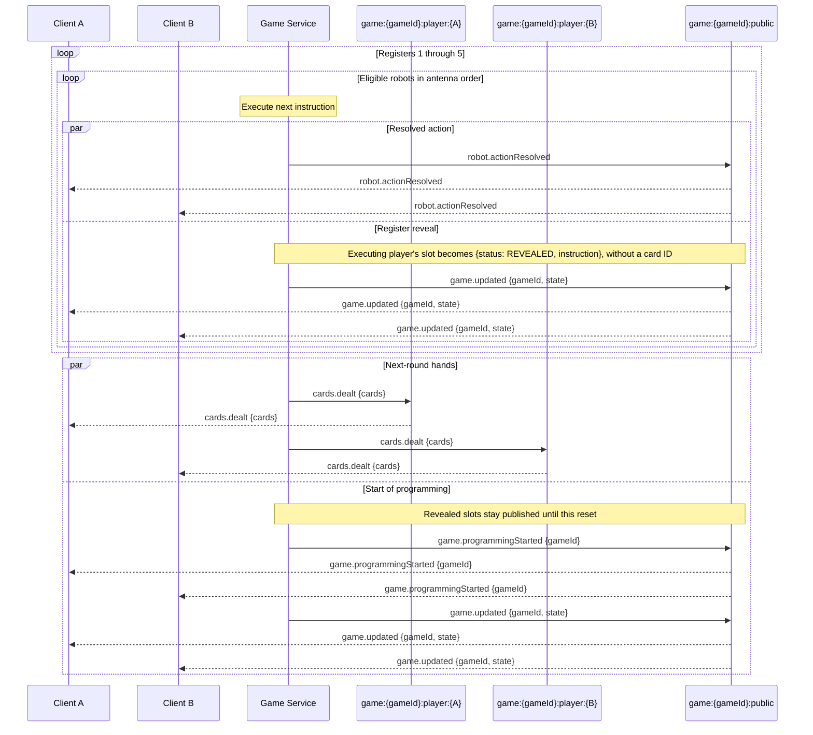
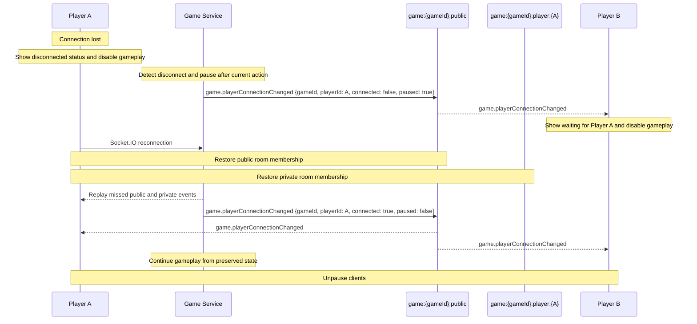
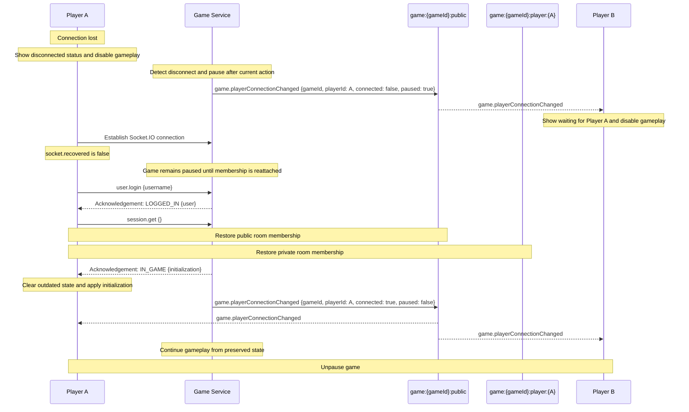

# Communication
The Client and Game Service use Socket.IO to communicate with each other. 
Client requests receive acknowledgement callbacks. Game state changes and gameplay updates are delivered as events.

This document describes the v0.5 communication flow. [AsyncAPI](asyncapi.yaml) defines the exact payloads and rejection codes, with a [rendered reference](asyncapi.html).

## Login and joining
The client logs in with a username and receives a user ID.

The client first logs in with a username:

`user.login`

A successful login returns:

`LOGGED_IN {user}`

The client then sends `session.get {}`. `NO_SESSION` continues to lobby selection, `IN_LOBBY {lobby}` confirms waiting membership on the same live connection (for example, after a command acknowledgement times out), and `IN_GAME {initialization}` restores an existing game. Disconnecting removes lobby membership; reconnecting does not rejoin that lobby.

To enter a new lobby, the client sends `lobby.create {}` or `lobby.join {lobbyId}` on the same socket. Creating uses a generated name and makes the creator the owner. A successful request returns `LOBBY_JOINED {lobby}` and enters the waiting screen.

Only the owner can send `lobby.start {lobbyId}`. The service creates a fresh game, moves every member into its public and private player rooms, and removes the lobby room and record. The service sends each player the following through their own `game:{gameId}:player:{playerId}` room:

`game.started {lobbyId, initialization: {outcome: JOINED, assignment, state, hand, programSubmitted}}`

The public room `game:{gameId}:public` still carries shared gameplay events. Initialization uses private rooms because it includes each player's hand.

Robot colours are assigned once by the service at Start and included in public state; clients retain them across departures and reconnects.

The owner also receives `STARTED {gameId}` as the command acknowledgement. The service constructs each initialization with the player's robot assignment, public state including every player's registers, private hand, and program-submission status. The client must apply it before processing later live game events. If a command times out, `session.get` discovers the committed session without repeating the mutation.

### Listing lobbies

After login, the client can ask which lobbies exist:

`lobby.list {}`

A successful request returns:

`LOBBIES_FOUND {lobbies}`

Each lobby includes its `lobbyId`, generated name, player count, and capacity. The client uses `lobbyId` to join. Listing is refreshed on entry or through Refresh. A connection that has not logged in receives `LOGIN_REQUIRED`, and a malformed request receives `INVALID_REQUEST`.

### Membership

New players join waiting lobbies, with a capacity of six. The owner may start with one or more members. Starting closes the game roster immediately, before any program submission; there is no direct game.join command.

While waiting, `lobby.leave {lobbyId}` or disconnecting removes membership. Leaving returns `LEFT` and retains login. Ownership passes to the earliest remaining member, announced through `lobby.updated {lobby}`. An empty lobby is deleted. A disconnected lobby member returns to browsing after reconnecting.

In case of disconnection during a game, existing members may reconnect at any time. If the tab is left open SocketIO will automatically try to reestablish the connection. In case of a closed tab, the player can reopen the webpage in another tab to reconnect. In case multiple tabs are used, the first connection to reclaim a disconnected membership becomes its owner. A later connection cannot replace that owner, even if its Socket.IO session was successfully recovered.

When an existing game member sends `session.get {}`, the server attaches the new connection to the existing player and robot and returns their current assignment and state through `IN_GAME {initialization}`.

If another live connection attempts to claim the same session for that user, session.get returns:

`USER_ALREADY_IN_SESSION`

A failed join leaves the user logged in and the client may attempt another join later.

An explicit `game.leave {gameId}` removes the owning connection's player and robot, frees the occupied tile, and revokes its public/private room access. `LEFT` retains login. Remaining members receive `game.playerLeft {gameId, playerId, robotId}`. A disconnected player remains a member; disconnecting is not leaving. Leaving does not reopen a game that has already started.

Reconnection behavior is described in the Reconnection section.

The following diagram documents logging in, listing lobbies and joining:

## Game has started
### Programming

During the programming phase, each player submits five distinct card IDs in register order for the current round.

The client sends:

`program.submit {gameId, playerId, cardIds}`

The service verifies that the submitted cards belong to the player and that the submission is valid for the current game phase.

A successful submission receives:

`ACCEPTED`

The server then emits:

`program.submitted {playerId}`

to the game's public room.

This informs other players that the player has submitted their program without revealing the submitted cards. The server waits until all players have successfully submitted before beginning activation.

### Submission failures

A submission can be rejected for a mismatched or malformed request, because the connection is not a member of the game, because the round has already moved past programming, because the player already has a stored program for this round, because the game is paused, or because of an unexpected service failure. See [AsyncAPI](asyncapi.yaml) for the exact rejection codes.

A rejected submission does not replace or modify the player's current program.

If the client receives no acknowledgement, the outcome is unknown. The client must not automatically resend the submission because the original request may have been accepted.

### Public registers

`PlayerState.registers` contains five slots in register order: `{status: EMPTY}` means no card is placed, `{status: HIDDEN}` means a card is placed without exposing its identity or instruction, and `{status: REVEALED, instruction}` shows an already-executed register. EMPTY and HIDDEN contain only their status; REVEALED contains the executed instruction without an instance ID. Each player's hand remains private.

`game.updateRegisters {gameId, playerId, occupied}` sends exactly five booleans: `true` maps to HIDDEN and `false` maps to EMPTY. Its acknowledgement, `game.updateRegistersResult {outcome}`, returns `ACCEPTED`, `INVALID_REQUEST`, `NOT_A_MEMBER`, `PLAYER_ID_MISMATCH`, `WRONG_PHASE`, `ALREADY_SUBMITTED`, or `INTERNAL_ERROR`.

During programming, before final submission, the client sends an occupancy update whenever a card is placed in or removed from a register. This shares only which slots are occupied; it does not submit a program. The final `program.submit {gameId, playerId, cardIds}` sends five distinct card instance IDs in register order.

`game.updated {gameId, state}` broadcasts the shared game state to `game:{gameId}:public` after an accepted occupancy update, when activation begins, and after each register execution. `state` carries the players, robots, phase, and antenna; clients keep the board from `game.started` or `session.get`.

`game.programmingStarted {gameId}` announces the start of programming to the public room and resets every player's registers to five EMPTY slots. The cleared registers arrive in the `game.updated` sent with it, and revealed slots stay published until then.

### Activation

Once all players have submitted, the service resolves the five registers in order. Within each register, eligible robots act according to antenna priority. Priority is recalculated after each robot action before the next robot acts.

Each resolved action is emitted publicly as `robot.actionResolved`.

The required `playerId` identifies whose register executed.

Clients must process resolved actions in the order in which they are received.

#### Activation ordering

The antenna is located at the top centre of the board and faces south.

The test board uses:

- position (10, 0)
- direction Math.PI / 2

The antenna does not occupy a robot tile.

Exact priority ties are resolved using player join order. The priority algorithm defines the complete robot action order.

If an unexpected service failure makes gameplay unrecoverable, members receive `game.aborted {gameId}` and the game ends permanently.

### Pits and rebooting

Entering a `PIT` stops the current movement instruction and immediately reboots the robot at the configured reboot tile. Blocked movement produces no entry effect. If the reboot tile is occupied, use the nearest free, non-pit tile by Manhattan distance, breaking ties top to bottom, then left to right.

Rebooting completes before the next action. `robot.actionResolved.position` and public snapshots contain the resulting position and unchanged orientation. No new event is added.

Programs and checkpoint progress are preserved; later registers continue normally. Damage, round cancellation, direction selection, board-edge falls and pit animations are deferred.

### Checkpoint progress

Tiles have an optional `checkpointNumber` alongside their walls and keep type `EMPTY`. Omit the number when there is no checkpoint. Numbers are positive integers, unique and consecutive from 1. Checkpoints stay at fixed positions and remain available to every player after completion. The demo board places checkpoint 1 at `(10, 6)` and checkpoint 2 at `(8, 9)`.

`PlayerState.lastCheckpoint` starts at 0 and persists across rounds and reconnections. `PublicGameState.checkpointCount` counts the checkpoint tiles. Both values are authoritative integers with `0 <= lastCheckpoint <= checkpointCount`. Clients cannot award or request changes to progress. The initialization snapshot supplies both values for every player.

After all remaining robots have acted in a register, a player completes the next numbered checkpoint if their robot ends on its tile. Passing over a checkpoint does not count; facing does not matter. The same check runs if a departure completes the register.

When progress changes, the service broadcasts to `game:{gameId}:public`:

`player.checkpointProgress {gameId, playerId, lastCheckpoint, checkpointCount}`

The event follows the related `robot.actionResolved`, or `game.playerLeft` when a departure completes a register, and precedes subsequent actions or private hands. Only remaining players receive it. Unchanged progress produces no event.

The client displays `lastCheckpoint/checkpointCount` for its assigned player, initially `0/x` or `0/0` without checkpoints. Apply events immediately, independently of queued movement animations. Ignore other games, unknown or removed players, and duplicate or older progress. Successful Socket.IO recovery replays missed events; failed recovery replaces progress from JOINED.

Progress updates leave robot positions, selected cards, phases, programming availability, playback, membership, pause behavior and private hands unchanged. Completing all checkpoints does not end the game.

### Dealing the next hand

After all five registers have been resolved, the service deals each player a private hand for the next programming round.

Each player receives:

`cards.dealt {cards}`

through their private Socket.IO room.

A new hand may arrive while the client is still playing animations from the previous activation. The client should store the new hand immediately but must not enable programming until all queued resolved actions have finished playing.

### Game sequence

A round runs in two phases, so it is shown as two sequences. Both cover a connected, unpaused game and only successful requests. Parallel blocks do not impose an order between their branches.

Both players have received their initial private hands through `game.started` or `session.get`. The occupancy update is shown for A, and B follows the same flow.

#### Programming

#### Activation

## Reconnection
A player’s game membership is independent of their connection to the server. When the connection is lost, the client must indicate that it is disconnected and prevent gameplay submissions until the connection and game state have been restored.

There are two possible reconnection paths:

1. Socket.IO connection state recovery succeeds and missed events are replayed.
2. Connection state recovery fails, so the client logs in and calls session.get to obtain a fresh authoritative snapshot.

### Pausing on disconnection

When the server detects that a player has disconnected, it pauses the game. An action already in progress completes, but no subsequent action is executed. The current game state is preserved.

Connected clients are informed that the game is paused and which players are disconnected.

All clients must disable gameplay while the game is paused.

The server must reject gameplay submissions received while the game is paused.

### Restoring the connections

After an unexpected connection loss, the client attempts to reconnect automatically through Socket.IO. If Socket.IO can reestablish the connection, it will try to replay missed events through its [connection state recovery mechanism](https://socket.io/docs/v4/connection-state-recovery). 

#### Successful connection state recovery 
If recovery succeeds and the client still retains its local game state, Socket.IO replays missed events.

The client applies the recovered events in order and continues using its existing player and robot assignments.

#### Failed connection state recovery

Once Socket.IO has reconnected, if state recovery was unsuccessful, the client performs the normal initialization flow by sending

`user.login`

followed by:

`session.get {}`

Because the user is already a game member, session.get restores the connection to the existing player and robot.

The returned `IN_GAME {initialization}` acknowledgement contains the current authoritative state.

The client replaces its local game state with the returned initialization before processing further game events.

Recovered lobby rooms are rejected with `SESSION_EXPIRED` because waiting disconnects remove membership. The client opens a fresh connection, logs in, and uses session.get to return to browsing or restore its current session.

### Resuming the game
The game remains paused while any remaining player is disconnected. Once all remaining players are connected, the server announces that the game has resumed before continuing gameplay from the preserved game state.

