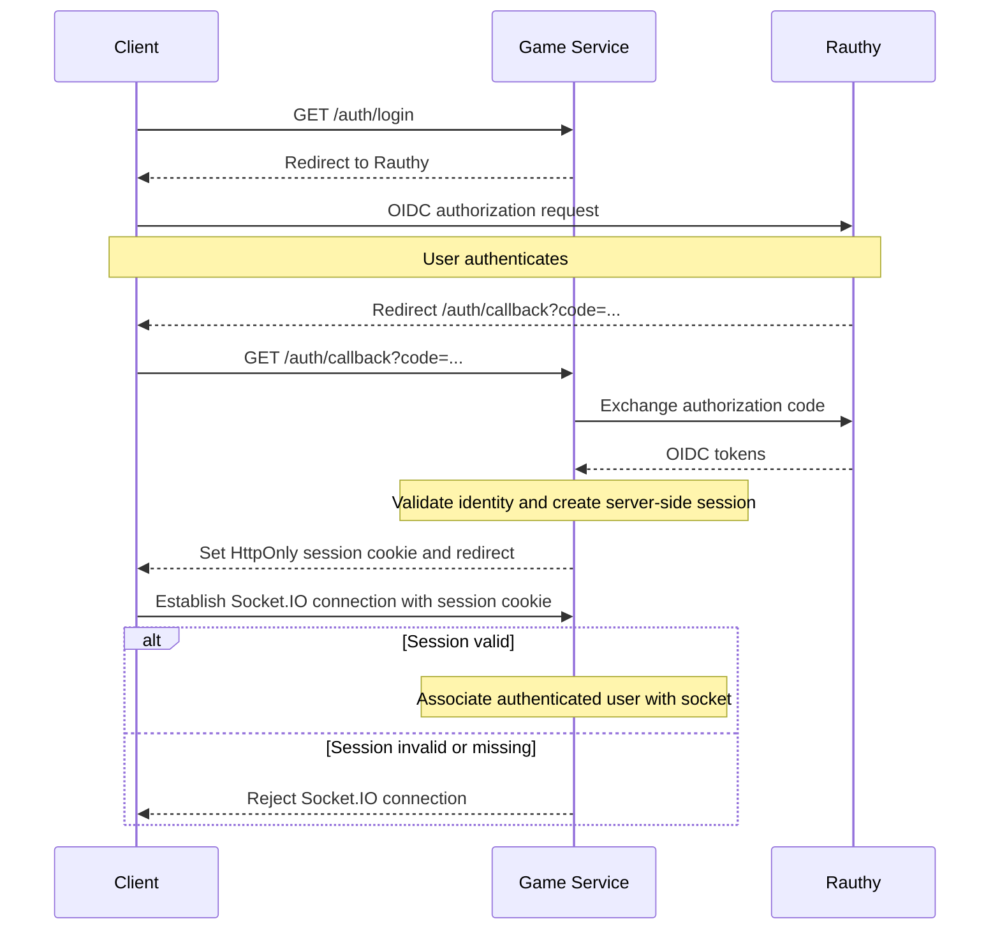
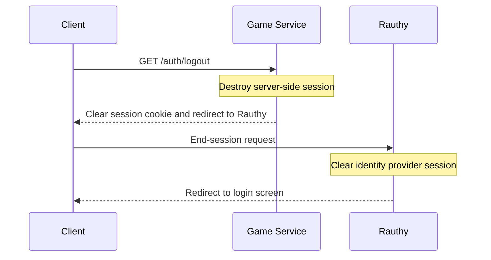
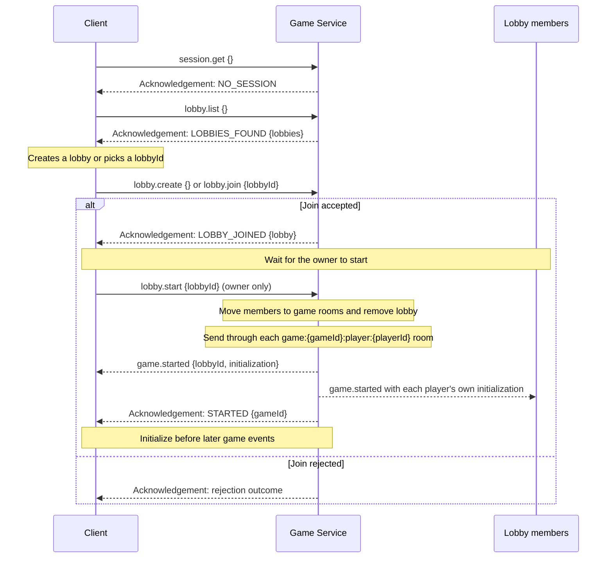
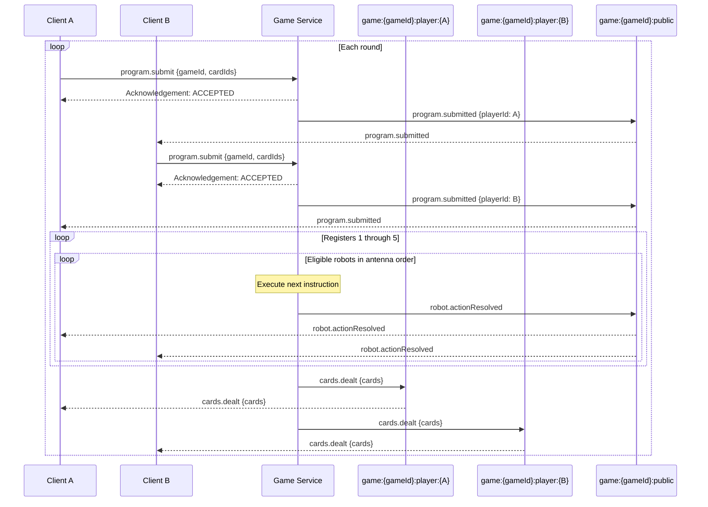
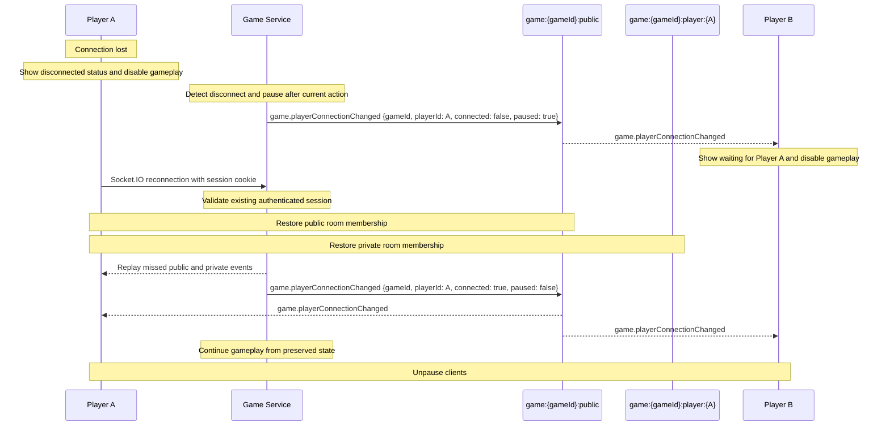
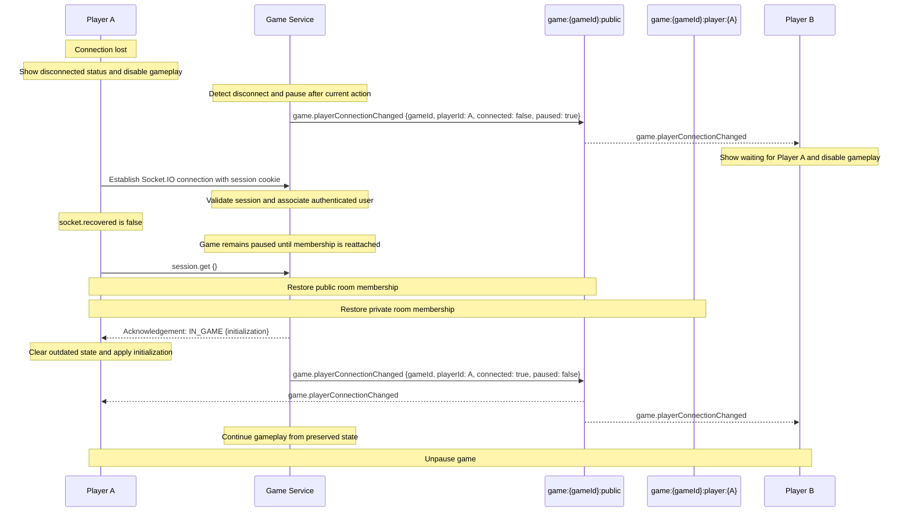

# Communication
The Client and Game Service use Socket.IO to communicate with each other. 
Client requests receive acknowledgement callbacks. Game state changes and gameplay updates are delivered as events.

This document describes the v0.6 communication flow. [AsyncAPI](asyncapi.yaml) defines the exact payloads and rejection codes, with a [rendered reference](asyncapi.html).

## Rooms

The service broadcasts lobby and gameplay events through three kinds of Socket.IO rooms:

- `lobby:{lobbyId}` — every connection currently waiting in that lobby.
- `game:{gameId}:public` — every connection currently a member of that game.
- `game:{gameId}:player:{playerId}` — only the connection currently attached to that player.

## Authentication
Authentication is handled using OpenID Connect (OIDC) with Rauthy. The Game Service acts as the Backend for Frontend (BFF) and maintains the authenticated browser session.

When the user is not authenticated, the browser starts login through the Game Service. The Game Service redirects the browser to Rauthy and completes the OIDC Authorization Code flow. After successful authentication, the Game Service creates a server-side session and returns a Secure, HttpOnly session cookie to the browser.

When the client establishes a Socket.IO connection, the browser includes the session cookie in the connection handshake. The Game Service validates the session before accepting the connection and associates the authenticated user with the socket. Unauthenticated Socket.IO connections are rejected.

The following diagram documents authentication:

### Logout

To log out, the client sends `GET /auth/logout` to the Game Service. The Game Service destroys the server-side session and clears the session cookie, then redirects the browser to Rauthy's end-session endpoint to terminate the identity provider session as well. Rauthy redirects back to the login screen once its session has been cleared.

## Lobby
After successful authentication, the client sends a `session.get` request to determine if the user has an existent session. 
If he does not, `session.get` acknowledges with `NO_SESSION` and the client is shown the lobby screen.

If a listed player disconnects before Start, `LOBBY_MEMBER_DISCONNECTED` leaves the lobby intact; the owner can retry after membership updates.

### Listing lobbies
The client then requets a list of existant lobbies via

`lobby.list`

A successful request returns:

`LOBBIES_FOUND {lobbies}`

From there the user has two options, creating a lobby or joining a lobby.

### Creating a lobby
The client sends `lobby.create`. As of this version there are no options and the server just assigns values for name and map. The creator becomes the lobbies owner. 

### Joining a lobby
Alternatively, the user can join an existing lobby. Once a lobby has been selected, the clients sends `lobby.join {lobbyId}`. 

### Starting a game
Both `lobby.join` and `lobby.create` acknowledge with `LOBBY_JOINED {lobby}` after which the client enters the waiting screen. All non owner users, then wait for the owner to start the game via `lobby.start {lobbyId}`. 

Once a game has successfully started , the onber receives `STARTED {gameId}` as the command acknowledgement. How the game is initialised is described in [Initialization](#initialization).

### Lobby Membership
`LOBBY_JOINED`, `IN_LOBBY`, and `lobby.updated` include the full `lobby.players` roster (`userId`, `username`) in join order. Clients replace their roster on each snapshot; `lobby.list` returns summaries only.

While waiting, `lobby.leave {lobbyId}` or disconnecting removes membership. Leaving returns `LEFT`. Ownership passes to the earliest remaining member, announced to the [lobby room](#rooms) through `lobby.updated {lobby}`. An empty lobby is deleted. A disconnected lobby member returns to browsing after reconnecting.

The following diagram documents the lobby lifecycle:

## Game has started
### Initialization
The service creates a fresh game, moves every member into its public and private player rooms, and removes the lobby room and record. The service sends each player the following through their own `game:{gameId}:player:{playerId}` room:

`game.started {lobbyId, initialization: {outcome: JOINED, assignment, state, hand, programSubmitted}}`

### Programming
During the programming phase, each player submits five distinct card IDs in register order for the current round.

The client sends:

`program.submit {gameId, cardIds}`

The service derives the player from the authenticated connection and the player's membership in the specified game. The service verifies that the submitted cards belong to that player and that the submission is valid for the current game phase.

A successful submission receives:

`ACCEPTED`

The server then emits:

`program.submitted {playerId}`

to the [public room](#rooms).

This informs other players that the player has submitted their program without revealing the submitted cards. The server waits until all players have successfully submitted before beginning activation.

### Activation

Once all players have submitted, the service resolves the five registers in order. Within each register, eligible robots act according to antenna priority. Priority is recalculated after each robot action before the next robot acts.

Each resolved action is emitted to the [public room](#rooms) as:

`robot.actionResolved`

Clients must process resolved actions in the order in which they are received.

A movement card can push a chain of robots. A wall or the antenna blocks the whole step. Pushed robots keep their facing direction and pending actions.

Movement resolves one square at a time. Robots entering pits or leaving the board reboot at once. The move stops if the acting robot reboots. A pushed robot rebooting does not stop it.

The event includes final positions after reboots: `position` for the acting robot and `pushedRobots` for other robots whose positions changed. Clients apply them together when the action plays.

#### Activation ordering

The antenna is located at the top centre of the board and faces south.

The test board uses:

- position (10, 0)
- direction Math.PI / 2

Robots cannot enter the antenna square.

The priority algorithm calculates the activation order based on the game rules.

### Checkpoint progress
Some tiles hold checkpoints. The demo board places checkpoint 1 at `(10, 6)` and checkpoint 2 at `(8, 9)`.

At the end of each register, the service checks each robot's final position for its next checkpoint. It broadcasts progress to the [public room](#rooms):

`player.checkpointProgress {gameId, playerId, lastCheckpoint, checkpointCount}`

The event follows the related `robot.actionResolved`.

### Dealing the next hand

After all five registers have been resolved, the service deals each player a private hand for the next programming round.

Each player receives:

`cards.dealt {cards}`

through the player's [private room](#rooms).

A new hand may arrive while the client is still playing animations from the previous activation. The client should store the new hand immediately but must not enable programming until all queued resolved actions have finished playing.

### Game sequence

The following sequence shows one complete round while the game remains connected and unpaused.

Both players have received their initial hands through game.started or session.get.

### Game Membership
In case of disconnection during a game, existing members may reconnect at any time. If the tab is left open SocketIO will automatically try to reestablish the connection. In case of a closed tab, the player can reopen the webpage in another tab to reconnect. In case multiple tabs are used, the first connection to reclaim a disconnected membership becomes its owner. A later connection cannot replace that owner, even if its Socket.IO session was successfully recovered.

When an existing game member sends `session.get {}`, the server attaches the new connection to the existing player and returns their current assignment and state through `IN_GAME {initialization}`.

If another live connection attempts to claim the same session for that user, session.get returns:

`USER_ALREADY_IN_SESSION`

A `session.get` rejected with `USER_ALREADY_IN_SESSION` leaves the authenticated session unaffected, and the client may call `session.get` again later.

An explicit `game.leave {gameId}` removes the owning connection's player and robot, frees the occupied tile, and revokes its public/private room access. Remaining members receive `game.playerLeft {gameId, playerId, robotId}` through the [public room](#rooms). A disconnected player remains a member. Disconnecting is not leaving.

A player’s game membership is independent of their Socket.IO connection to the server. The authenticated browser session is also independent of the Socket.IO connection. When the connection is lost, the client must indicate that it is disconnected and prevent gameplay submissions until the connection and game state have been restored.

There are two possible reconnection paths:

1. Socket.IO connection state recovery succeeds and missed events are replayed.
2. Connection state recovery fails, so the client establishes a new authenticated Socket.IO connection and calls `session.get` to obtain a fresh authoritative snapshot.

#### Pausing on disconnection
When the server detects that a player has disconnected, it pauses the game. An action already in progress completes, but no subsequent action is executed. The current game state is preserved.

The server announces this to the [public room](#rooms):

`game.playerConnectionChanged {gameId, playerId, connected: false, paused: true}`

All clients must disable gameplay while the game is paused.

The server must reject gameplay submissions received while the game is paused.

#### Restoring the connections

After an unexpected connection loss, the client attempts to reconnect automatically through Socket.IO. If the session is still valid, the Game Service associates the authenticated user with the connection. If Socket.IO can reestablish the connection, it will try to replay missed events through its [connection state recovery mechanism](https://socket.io/docs/v4/connection-state-recovery). 

##### Successful connection state recovery 
If recovery succeeds and the client still retains its local game state, Socket.IO replays missed events.

The client applies the recovered events in order and continues using its existing player and robot assignments.

##### Failed connection state recovery
Once Socket.IO has reconnected, if state recovery was unsuccessful the client must reinitialize.

The client performs the normal game initialization flow by sending:

`session.get {}`

Because the user is already a game member, session.get restores the connection to the existing player and robot.

The returned `IN_GAME {initialization}` acknowledgement contains the current authoritative state.

The client replaces its local game state with the returned initialization before processing further game events.

The game remains paused while any remaining player is disconnected. Once all remaining players are connected, the same `game.playerConnectionChanged` event (now with `paused: false`) announces that the game has resumed, and gameplay continues from the preserved game state.

## Errors and rejections

Most commands acknowledge failures with a specific outcome string rather than throwing. See [AsyncAPI](asyncapi.yaml), with a [rendered reference](asyncapi.html), for the exact payload shapes and the full set of rejection codes per command.

If an unexpected service failure makes gameplay unrecoverable, members receive `game.aborted {gameId}` through the [public room](#rooms), and the game ends permanently.

