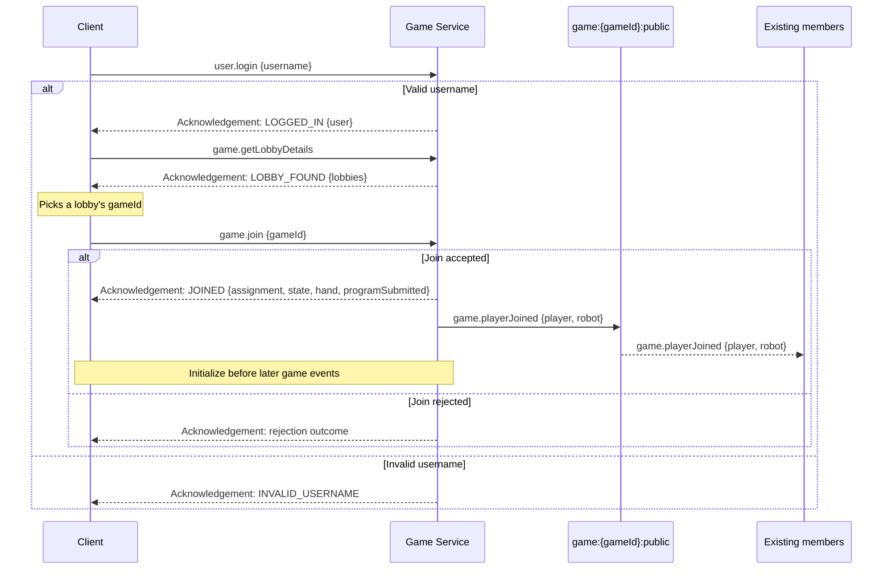
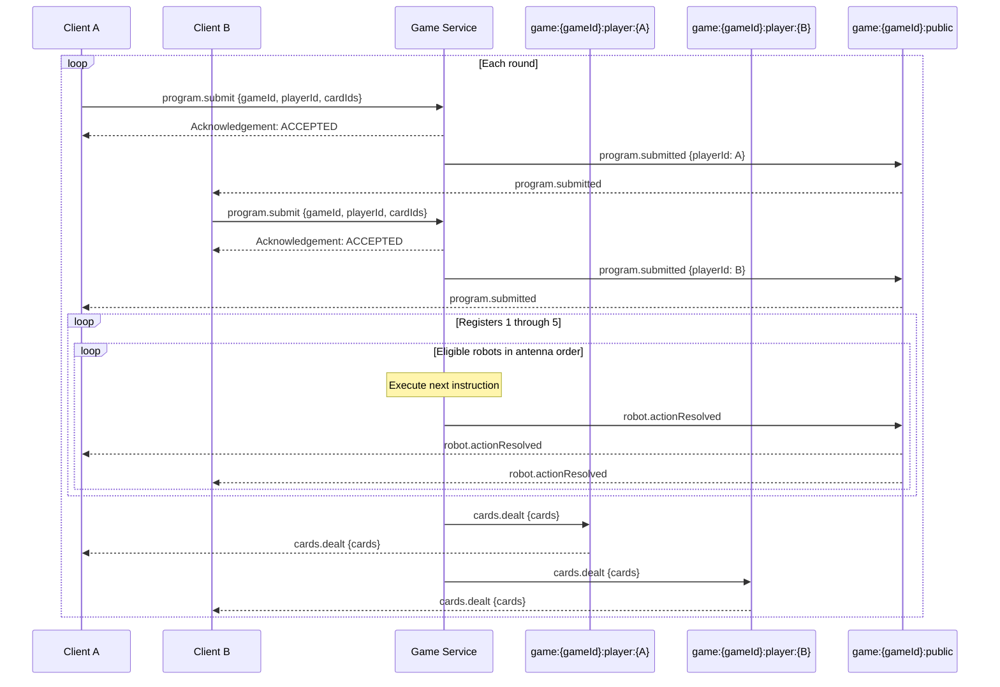
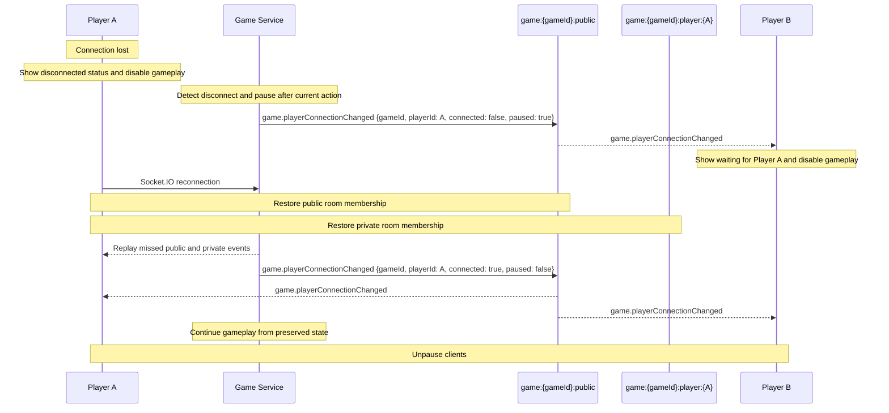
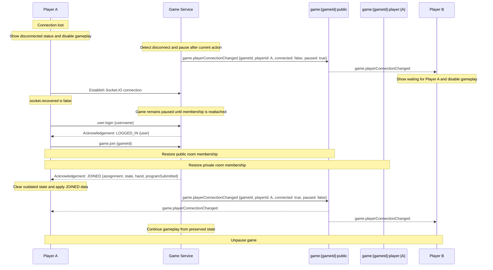

# Communication
The Client and Game Service use Socket.IO to communicate with each other. 
Client requests receive acknowledgement callbacks. Game state changes and gameplay updates are delivered as events.

This document describes the v0.5 communication flow. [AsyncAPI](asyncapi.yaml) defines the exact payloads and rejection codes, with a [rendered reference](asyncapi.html).

## Login and joining
The client logs in with a username and receives a user ID.

The client first logs in with a username:

`user.login`

A successful login returns:

`LOGGED_IN {user}`

The client then sends:

`game.join {gameId}`

on the same socket for the configured game.

A successful join returns:

`JOINED {assignment, state, hand, programSubmitted}`

The acknowledgement contains the player's current robot assignment, public game state, private hand, and program-submission status. The client must apply all JOINED data before processing later live game events. A future lobby may be inserted between login and joining without changing this model.

### Listing lobbies

After login, the client can ask which lobbies exist:

`game.getLobbyDetails`

A successful request returns:

`LOBBY_FOUND {lobbies}`

Each lobby includes its `gameId`, which the client uses to send `game.join`. A connection that has not logged in receives `LOGIN_REQUIRED`, and a malformed request receives `INVALID_REQUEST`.

### Membership

New players may join a game until the server accepts the first program submission. Accepting that submission starts the game and permanently closes joining to new players. Later attempts by new players receive GAME_ALREADY_STARTED. 

In case of disconnection, existing members may reconnect at any time. If the tab is left open SocketIO will automatically try to reestablish the connection. In case of a closed tab, the player can reopen the webpage in another tab to reconnect. In case multiple tabs are used, the first connection to reclaim a disconnected membership becomes its owner. A later connection cannot replace that owner, even if its Socket.IO session was successfully recovered. 

When an existing member sends game.join while not being connected, the server attaches the new connection to the existing player and robot and returns their current assignment and state through JOINED.

If another connection attempts to join the same game for that user, it receives:

`USER_ALREADY_IN_GAME`

A failed join leaves the user logged in and the client may attempt another join later.

An explicit `game.leave {gameId}` removes the owning connection's player and robot, frees the occupied tile, and revokes its public/private room access. `LEFT` retains login. Remaining members receive `game.playerLeft {gameId, playerId, robotId}`. A disconnected player remains a member; disconnecting is not leaving. Leaving does not reopen a game that has already started.

Reconnection behavior is described in the Reconnection section.

The following diagram documents logging in, listing lobbies and joining:

## Game has started
### Programming

During the programming phase, each player submits five distinct card IDs in register order for the current round.

The client sends:

`program.submit {gameId, playerId, cardIds}`

The service verifies that the submitted cards belong to the player and that the submission is valid for the current game phase.

A successful submission receives:

`ACCEPTED`

The server then emits:

`program.submitted {playerId}`

to the game's public room.

This informs other players that the player has submitted their program without revealing the submitted cards. The server waits until all players have successfully submitted before beginning activation.

### Submission failures

A submission can be rejected for a mismatched or malformed request, because the connection is not a member of the game, because the round has already moved past programming, because the player already has a stored program for this round, because the game is paused, or because of an unexpected service failure. See [AsyncAPI](asyncapi.yaml) for the exact rejection codes.

A rejected submission does not replace or modify the player's current program.

If the client receives no acknowledgement, the outcome is unknown. The client must not automatically resend the submission because the original request may have been accepted.

### Activation

Once all players have submitted, the service resolves the five registers in order. Within each register, eligible robots act according to antenna priority. Priority is recalculated after each robot action before the next robot acts.

Each resolved action is emitted publicly as:

`robot.actionResolved`

Clients must process resolved actions in the order in which they are received.

#### Activation ordering

The antenna is located at the top centre of the board and faces south.

The test board uses:

- position (10, 0)
- direction Math.PI / 2

The antenna does not occupy a robot tile.

Exact priority ties are resolved using player join order. The priority algorithm defines the complete robot action order.

If an unexpected service failure makes gameplay unrecoverable, members receive `game.aborted {gameId}` and the game ends permanently.

### Checkpoint progress

Tiles have an optional `checkpointNumber` alongside their walls and keep type `EMPTY`. Omit the number when there is no checkpoint. Numbers are positive integers, unique and consecutive from 1. Checkpoints stay at fixed positions and remain available to every player after completion. The demo board places checkpoint 1 at `(10, 6)` and checkpoint 2 at `(8, 9)`.

`PlayerState.lastCheckpoint` starts at 0 and persists across rounds and reconnections. `PublicGameState.checkpointCount` counts the checkpoint tiles. Both values are authoritative integers with `0 <= lastCheckpoint <= checkpointCount`. Clients cannot award or request changes to progress. JOINED supplies both values; `game.playerJoined` includes the new player's initial progress.

After all remaining robots have acted in a register, a player completes the next numbered checkpoint if their robot ends on its tile. Passing over a checkpoint does not count; facing does not matter. The same check runs if a departure completes the register.

When progress changes, the service broadcasts to `game:{gameId}:public`:

`player.checkpointProgress {gameId, playerId, lastCheckpoint, checkpointCount}`

The event follows the related `robot.actionResolved`, or `game.playerLeft` when a departure completes a register, and precedes subsequent actions or private hands. Only remaining players receive it. Unchanged progress produces no event.

The client displays `lastCheckpoint/checkpointCount` for its assigned player, initially `0/x` or `0/0` without checkpoints. Apply events immediately, independently of queued movement animations. Ignore other games, unknown or removed players, and duplicate or older progress. Successful Socket.IO recovery replays missed events; failed recovery replaces progress from JOINED.

Progress updates leave robot positions, selected cards, phases, programming availability, playback, membership, pause behavior and private hands unchanged. Completing all checkpoints does not end the game.

### Dealing the next hand

After all five registers have been resolved, the service deals each player a private hand for the next programming round.

Each player receives:

`cards.dealt {cards}`

through their private Socket.IO room.

A new hand may arrive while the client is still playing animations from the previous activation. The client should store the new hand immediately but must not enable programming until all queued resolved actions have finished playing.

### Game sequence

The following sequence shows one complete round while the game remains connected and unpaused.

Both players have already joined and received their initial hands in their JOINED acknowledgements.

## Reconnection
A player’s game membership is independent of their connection to the server. When the connection is lost, the client must indicate that it is disconnected and prevent gameplay submissions until the connection and game state have been restored.

There are two possible reconnection paths:

1. Socket.IO connection state recovery succeeds and missed events are replayed.
2. Connection state recovery fails, so the client logs in and joins the game again to obtain a fresh authoritative snapshot.

### Pausing on disconnection

When the server detects that a player has disconnected, it pauses the game. An action already in progress completes, but no subsequent action is executed. The current game state is preserved.

Connected clients are informed that the game is paused and which players are disconnected.

All clients must disable gameplay while the game is paused.

The server must reject gameplay submissions received while the game is paused.

### Restoring the connections

After an unexpected connection loss, the client attempts to reconnect automatically through Socket.IO. If Socket.IO can reestablish the connection, it will try to replay missed events through its [connection state recovery mechanism](https://socket.io/docs/v4/connection-state-recovery). 

#### Successful connection state recovery 
If recovery succeeds and the client still retains its local game state, Socket.IO replays missed events.

The client applies the recovered events in order and continues using its existing player and robot assignments.

#### Failed connection state recovery

Once Socket.IO has reconnected, if state recovery was unsuccessful, the client performs the normal initialization flow by sending

`user.login`

followed by:

`game.join`

Because the user is already a game member, game.join restores the connection to the existing player and robot.

The returned JOINED acknowledgement contains the current authoritative state.

The client replaces its local game state with the returned JOINED data before processing further game events.

### Resuming the game
The game remains paused while any remaining player is disconnected. Once all remaining players are connected, the server announces that the game has resumed before continuing gameplay from the preserved game state.

