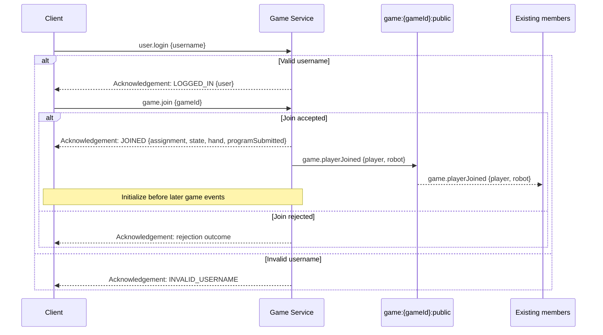
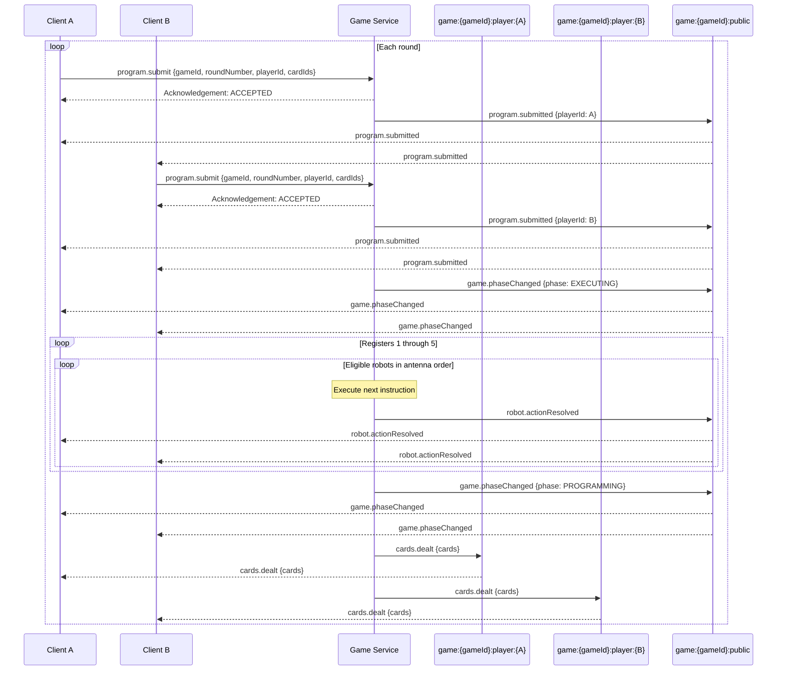

# Communication

The browser and Game Service use Socket.IO. Requests receive acknowledgement
callbacks; game updates arrive as events. This guide describes the v0.5 flow.
[AsyncAPI](asyncapi.yaml) defines the exact payloads and rejection codes, with a
[rendered reference](asyncapi.html).

## Login and joining

A username contains 1–30 Unicode code points. The service preserves it exactly,
without trimming or character restrictions, and returns a user ID. Login creates
no player, robot, or game membership.

The client then sends `game.join` on the same socket for the configured game.
`JOINED` returns the player/robot assignment, public state, private hand, and
submission status together. The client applies them before live game events; it
does not request a second initial snapshot or hand. A future lobby can fit between
login and joining.

Multiple connections may log in as the same user, but only one may join a given
game. Another connection receives `USER_ALREADY_IN_GAME`. A failed join leaves the
user logged in and may be retried. Only the connection that joined may read that
game's snapshot through `game.getPublicGameState`; nonmembers receive
`GAME_NOT_FOUND` without state.

## Programming and activation

Each player submits five distinct card IDs in register order for the current round.
The service checks ownership and waits until all current players have submitted.
It then announces `EXECUTING` and resolves five registers. Within each register,
robots act in antenna priority order, recalculated after each action. Afterward,
the service announces the next `PROGRAMMING` round and deals each player a private
hand. Clients play resolved actions in event order before enabling programming.

The sequence keeps public and private Socket.IO rooms visible. Both clients have
already joined and received their initial hand in the `JOINED` acknowledgement.

`INVALID_PROGRAM` rejects a malformed, stale, duplicate, unauthorized, or
wrong-phase submission without changing the program. `INTERNAL_ERROR` means the
service failed before accepting it. If no acknowledgement arrives, the outcome
is unknown; the client must not resend automatically.

## Membership and playback

Players may join or leave at any point. A join during programming counts toward
that round. A join during activation places the robot on the board, but it sits
out until the next programming phase and receives `hand: []` initially. Leaving
during programming rechecks whether all remaining players have submitted;
leaving during activation cancels only that robot's future actions. An empty game
stays idle. A waiting robot can still block movement; handle joins and leaves
between robot actions. If no eligible robots remain, end activation once and
begin the next programming round. Explicit `game.leave` keeps the user logged
in; disconnect removes membership and requires login on a new connection.

The antenna is at the top centre of the board, facing south. The test board uses
`(10, 0)` and `Math.PI / 2`; exact ties use join order. It does not occupy a robot
tile. [The priority algorithm](game_model_UML.md#robot-priority-typescript-reference-implementation)
defines the action order.

The client uses `VITE_GAME_ID` for the shared game and `VITE_GAME_SERVICE_URL` for
the service. It listens before joining, applies the `JOINED` result together, and
then processes later events in order. It keeps programming locked during
activation, after submission, without a hand, or while playback is running.
A hand may arrive before playback ends; keep it until all queued actions finish.
Queue removals and phase changes behind earlier resolved actions.
Login and join requests may be retried manually after a five-second timeout on
the same socket; repeated requests reuse the existing identity or assignment.
