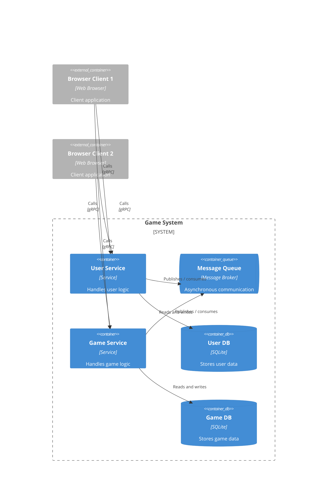

<!-- LTeX: language=en-US -->
# Decision Summary
TODO

# Goals
This design document is intended to document our decisions regarding the architecture of this project.

It should clearly define:
1. The services we are planning to develop
2. Protocols used for communication between given services

# Non Goals
This document won't define the interface between the services. It will only define the technologies we use. The interface can onlybe defined once this document has been approved.

# Last Meetings initial proposal
We discussed separating User logic from Game logic by creating two seperate serivces. Each service should have their own database.We discuesed to keep it simple and rely on sqllite instead of setting up a DB server. Clients communicate with the User service for user account actions and authentication. All other communication, which is specifically related to the game logic, they communicate with the game service. 

For protocolls we thought about using GRPC for client to service communication and a message queue for service to service communication. This proposal was based more on intuition than arguments and should be evaluated in this document.

# Evaluation of architecture

## Seperation of services
**Requirement**: Seoperation of User and Game logic. Most specific information does not have to be visible to the game service.
**Old proposal**: Seperate Game Logic from User logic through two distinct servcices, each having their distinc database
**Alternative**: Implementing the seperation trhough modules in a single service

**Evaluation**: The earlier discussed seperation between a user and a game service, each having a seperate database, makes a lot of sense to me.
Through this seperation we automatically get a clear ownership of data as well as better security boundaries. While it is possible to implement this via a single service by implementing seperate modules, we would have to be more careful during development to uphold these boundaries.

## Communication between services
**Requirement**: The game service needs to be able to tell whether a user is authenticated. 

**Old proposal**: Game service asks the user service whether a user is authenticated via a message queue
Alternative: No communication between services. 

**Evaluation**: Depending on what functionallity we want to implement later it might be possible to not have any communication betweenboth services at all. For authentication purposes we certainly don't need it. The user would authenticate via the user service and receive a signed token. He would then supply this token to the game service. The game service can verify that the token has been signed by the user service via the user services public key. 
If we want to later display more information about users in the client we might need some service to service communication. But for now it would be simpler to omit it and reevalute our options when it comes to it.

