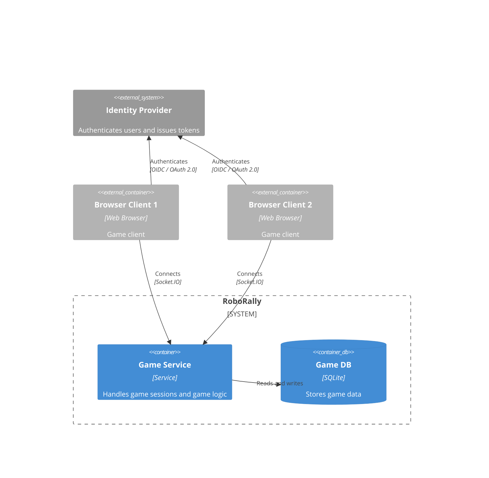
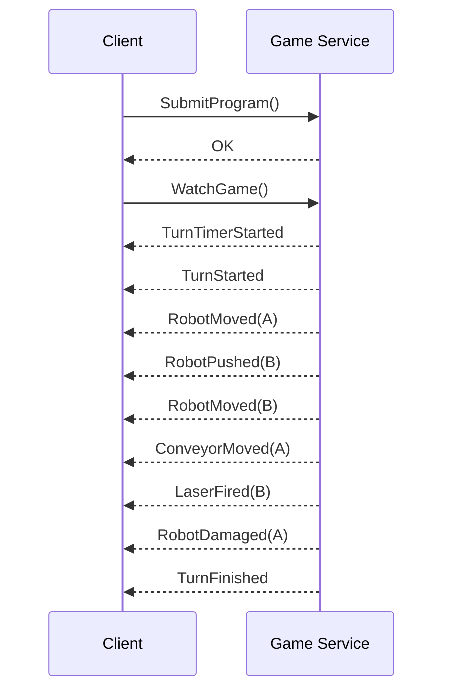
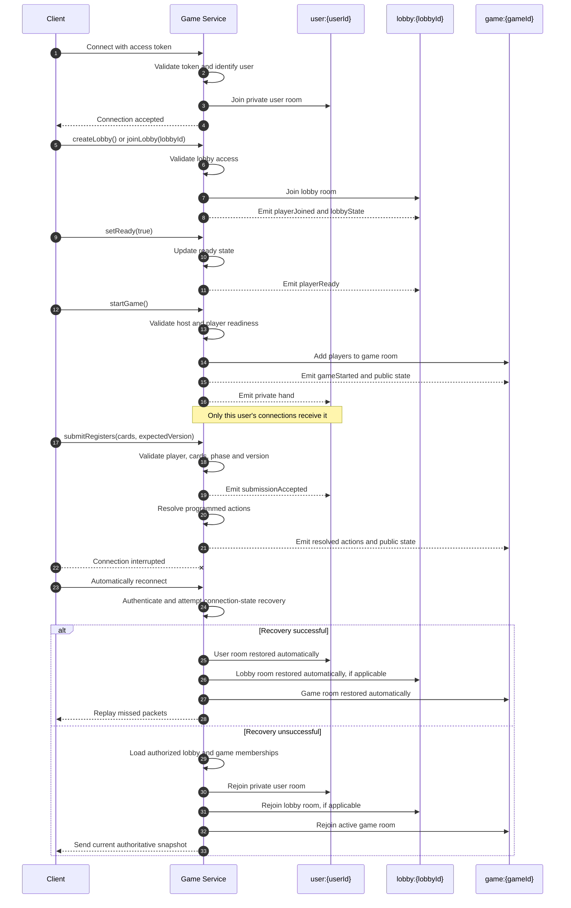

<!-- LTeX: language=en-US -->
# Decision Summary

The project uses browser-based clients that authenticate through an external Identity Provider. After authentication, clients communicate with the Game Service over Socket.IO for the games core logic. The Game Service handles game logic and persists game data in a local SQLite database.  For certain features that don't need bidirectional, asynchronous communication it might make sense to also support communication via http or another similar protocol. 

# Goals
This design document is intended to document our decisions regarding the architecture of this project.

It should clearly define:
1. The services we are planning to develop
2. Protocols used for communication between given services

# Non Goals
This document won't define the interface between the services. It will only define the technologies we use. The interface can only be defined once this document has been approved.

# Last Meetings initial proposal
We discussed separating User logic from Game logic by creating two separate services. Each service should have their own database. We discussed keeping it simple and rely on sqllite instead of setting up a DB server. Clients communicate with the User service for user account actions and authentication. All other communication, which is specifically related to the game logic, they communicate with the game service. 

For protocols, we thought about using GRPC for client to service communication and a message queue for service to service communication. This proposal was based more on intuition than arguments and should be evaluated in this document.

# Evaluation of architecture

## Separation of services

**Requirements**: 
1. Separation of User and Game logic. Most specific information does not have to be visible to the game service.  
2. Application services should not store or process user passwords. User authentication and credential storage shall be delegated to an identity provider supporting industry-standard authentication protocols.

**Old proposal**:
Separation of Game Logic from User logic through two distinct services, each having their distinct database. The user database contains both user credentials and potentially user specific settings (depending on the scope of our implementation).

**Alternative**: 
Instead of handling authentication logic ourselves we use an identity provider. In case we want to develop a lot of user specific settings, a user service might still make sense for other user data.

**Evaluation**:
We should not self develop authentication mechanisms. Therefore, the user database should not contain any credentials. Authentication and token management should be offloaded to an identity provider. This brings up whether we need a game service at all. This depends on how much user specific settings we want to support. If there are very little or none at all, there is a solid argument for omitting such a service. Since we don't know the scope of the project, yet I think omitting the user service is reasonable.

**Open questions**:
What identity provider do we want to use? I have no experience with this. DO we want to self-host? https://docs.goauthentik.io seems pretty straightforward to set up with docker. 

## Service to Service communication

**Requirement**: 
The game service needs to be able to tell whether a user is authenticated. 

**Old proposal**: 
Game service asks the user service whether a user is authenticated via a message queue

**Alternative**:
No communication between services. 

**Evaluation**: The user servise is dropped. For authentication purposes we don't necessaryly need communication between game service and the identity provider. The client would authenticate via the identity provider and receive a signed token which would then be supplied to the game service. The game service can verify that the token has been signed by the identity provider via the identity providers public key. The only reason why we would need communication between game service and identity provider is if we don't want to statically supply the certificate. I think we can consider key rotation out of scope.

## Database Choice

**Requirement**: A service needs to be able to reliably persist data

**Initial Proposal**: SQLight Databases per service

**Alternative**: PostgreSQL Databases

**Evaluation**: 
There are two main shortcomings of an embedded DB such as SQLight. They both relate to scale. If our server would be under a high load, it might become necessary to create multiple instances, potentially running on multiple servers. With Postgres, we could simply point all instances of our services to the Postgres database server. With SQLight we would need to mount the file to our application servers. At this scale, and potentially even before, another weakness of SQLight would come to light. SQLight doesn't support concurrent writes. However, in this projects' context we will never reach a high amount of concurrent writes, nor will writes become complicated and long. SQLight should still be able to handle a couple of thousands writes per second, which is more than enough for our use case. The main advantage is simplicity. We wouldn't have to manage a database server. Given that SQLight meets our performance requirements, I would prioritize this simplicity and focus our time on other areas.

## Client to Server Communication

### User Service
As I have argued above against a user service (at least for the initial design), I will not argue for a protocol. If we decide to go with a user service later on, we would need to define which functionality this service would offer and only then can we argue for an appropriate protocol.

### Game service

**Requirements**:
1. Web clients should support this protocol
2. Communication should be encrypted in transit
3. Reliable ordered delivery of messages
4. The protocol should either support bidirectional communication or 1-n streaming

**Initial proposal**:
Initially we thought of using grpc. 
gRPC-Web only supports server streaming. This could be good enough. We could implement a combination of unary/streaming requests. For example this could look like: 

From what I have read even with gRPC-Web the web implementation isn't optimal. It introduces the need for a proxy in between the client and the service which translates http calls into rpc calls. 

**Alternative**
**Websockets** 
Websockets support bidirectional communication and is widely supported in modern browsers. 

We could use the Socket.IO library which adds a couple of useful features which we would have to implement ourselves with grpc:
1. Automatic Reconnection and Packet Buffering: Through a heartbeat mechanism the lifelines of the connection is checked. The library support automatic reconnection and sending of buffered (undelivered) packages on reconnect
2. Broadcasting: SocketIo supports rooms and broadcasting of messages to these rooms.

Through the room feature we can easily model player lobbies and game rooms and broadcast messages to all relevant users.
A user would be member to up to 3 rooms:
1. user room: Contains private user messages such as which cards are being played 
2. game room: Contains all messages all players in a given game should receive (eg. RobotMoved(A)) 
3. lobby room: used to set up games and contains messages such as PlayerJoined(A))

I have created an (incomplete and not quite correct!) sequence diagram highlighting the above:

Using SocketIo doesn't give us contracts by default. But we can use typescript specific schema libraries such as Zod to enforce types. 
We should not limit ourselves to this protocol. Some features such as displaying leaderboards might not need bidirectional, asynchronous communication. This should be evaluated on a case by case basis. And we might have to think about enabling communication via multiple protocols.
