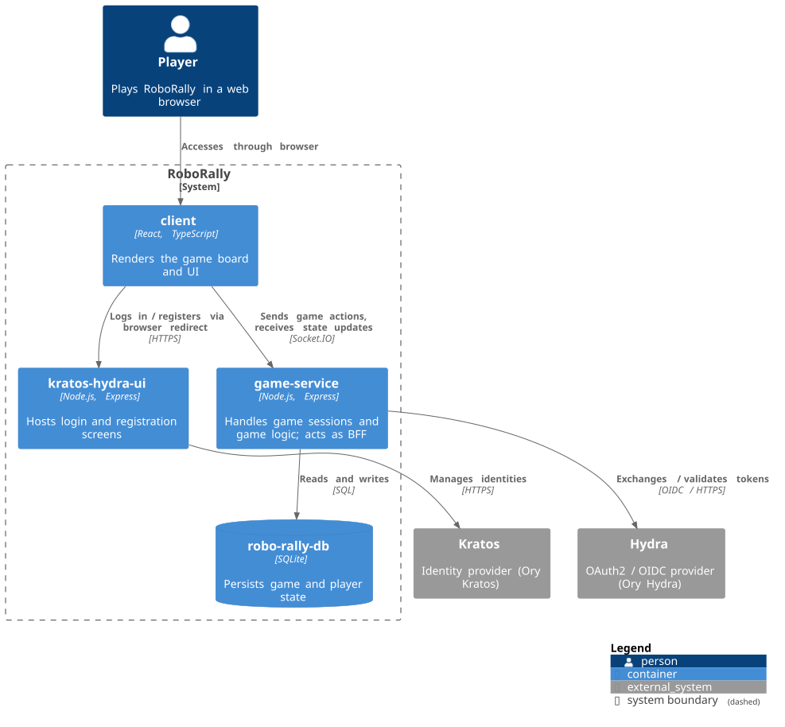
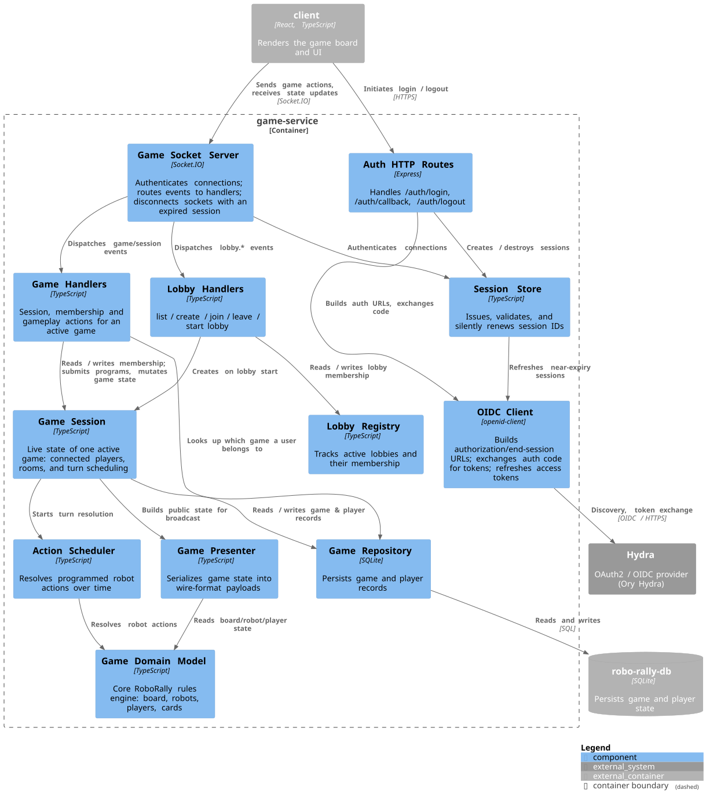

# Architecture

This section describes RoboRally's software architecture: first the overall system, then the internal structure of `game-service`.

## System Architecture

The following diagram shows the four containers we are building, together with the two external identity systems the system depends on.

Source: [system.puml](figures/system.puml)

The `client` is a React single-page application that runs in the player's browser. It renders the game board and user interface, and communicates with the backend over Socket.IO for real-time game actions and state updates.

The `game-service` is the system's backend. It owns two responsibilities: it runs the actual game logic (lobbies, turns, robot movement), and it acts as the OIDC relying party for the client, following the Backend-for-Frontend (BFF) pattern. Authentication is handled server-side so that access tokens never reach the browser. The client only ever holds a session cookie.

Authentication and game logic are independent domains and could be split into separate services. We chose to keep them combined, following KISS and YAGNI: the added operational complexity of a second service isn't justified until an actual need for it — independent scaling, independent deployment — actually arises.

`kratos-hydra-ui` hosts the login and registration screens the player is redirected to during authentication. It is currently vendored from Ory's reference implementation and is expected to be replaced with a customized application over time to fit the project's visual design.

`robo-rally-db` is a SQLite database that persists session, game, and player state, so that progress survives a service restart.

`Kratos` and `Hydra` are external, self-hosted systems from the Ory ecosystem. Kratos manages user identities and credentials. Hydra is the OAuth2/OIDC provider that issues and validates tokens. Neither is built or maintained by us.

At a high level, the player authenticates through `kratos-hydra-ui`, which is driven by Hydra and backed by Kratos. Once authenticated, the client communicates exclusively with `game-service`, which validates and exchanges tokens with Hydra directly and persists game state to `robo-rally-db`.

## Component View: `game-service`

The following diagram shows `game-service` split into its authentication components and its game-management components. These two parts share one component, the Session Store. Auth HTTP Routes create a session on login and destroy it on logout, while the Game Socket Server reads from the Session Store to authenticate every incoming Socket.IO connection.

Source: [component-combined.puml](figures/component-combined.puml)

### Authentication

The **Auth HTTP Routes** component exposes the service's three authentication endpoints: login, callback, and logout. It delegates the actual OIDC protocol work to the **OIDC Client**, which builds authorization and end-session URLs and exchanges authorization codes for tokens with Hydra.

On a successful login, a session is created in the **Session Store**. The Session Store owns the session's validity logic: generating session IDs, checking expiry, and silently renewing a session via the **OIDC Client** shortly before it expires. It uses the **Session Repository** to persist and retrieve sessions from the `robo-rally-db`.

### Game Management

Socket.IO connections are accepted by the **Game Socket Server**, which authenticates each connection against the Session Store and dispatches incoming events to one of two handler groups, matching the pre-game and in-game phases of a session. The Game Socket Server also re-validates the session on every subsequent command and before every broadcast, disconnecting the socket immediately if the session has since expired.

**Lobby Handlers** implement listing, creating, joining, leaving, and starting a lobby. Lobby membership is tracked by the **Lobby Registry**, an in-memory-only component. Lobbies are not persisted in this version, since a waiting room carries no value worth protecting across a restart. Most other games also don't support lobby persistence so this is what a user would likely expect.

**Game Handlers** implement the actions available once a game has started: reattaching after a reconnect, leaving, and submitting a program. A started lobby is converted into a **Game Session**, which holds the live state of one running game (e.g. connected players and Socket.IO rooms). Game state is persisted through the **Game Repository** to `robo-rally-db` so players can reload a game. Game Handlers resolve which game a user currently belongs to via the Game Repository.

Turn resolution is delegated to the **Action Scheduler**, which resolves programmed robot actions against the **Domain Model**. The Domain Model is the RoboRally rules engine, comprising the board, robots, players, and cards. The **Game Presenter** reads from the Domain Model and serializes game state into the wire-format payloads sent back to clients.

## Component View: `client`

TODO
