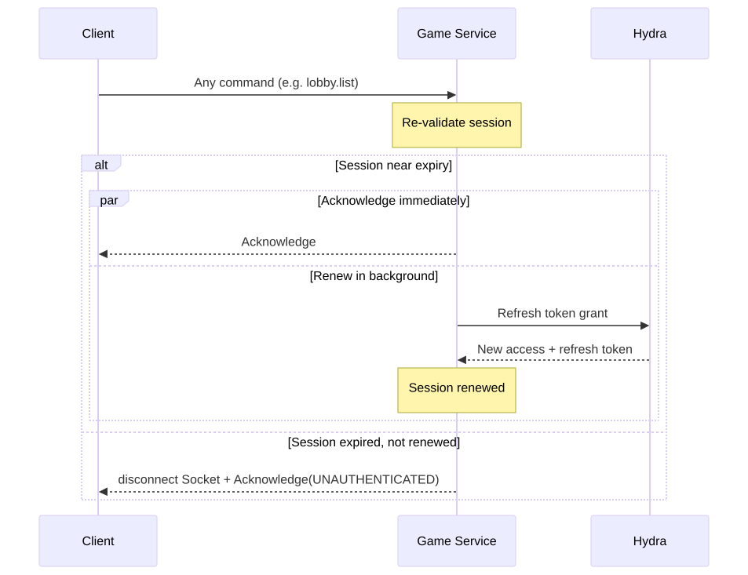
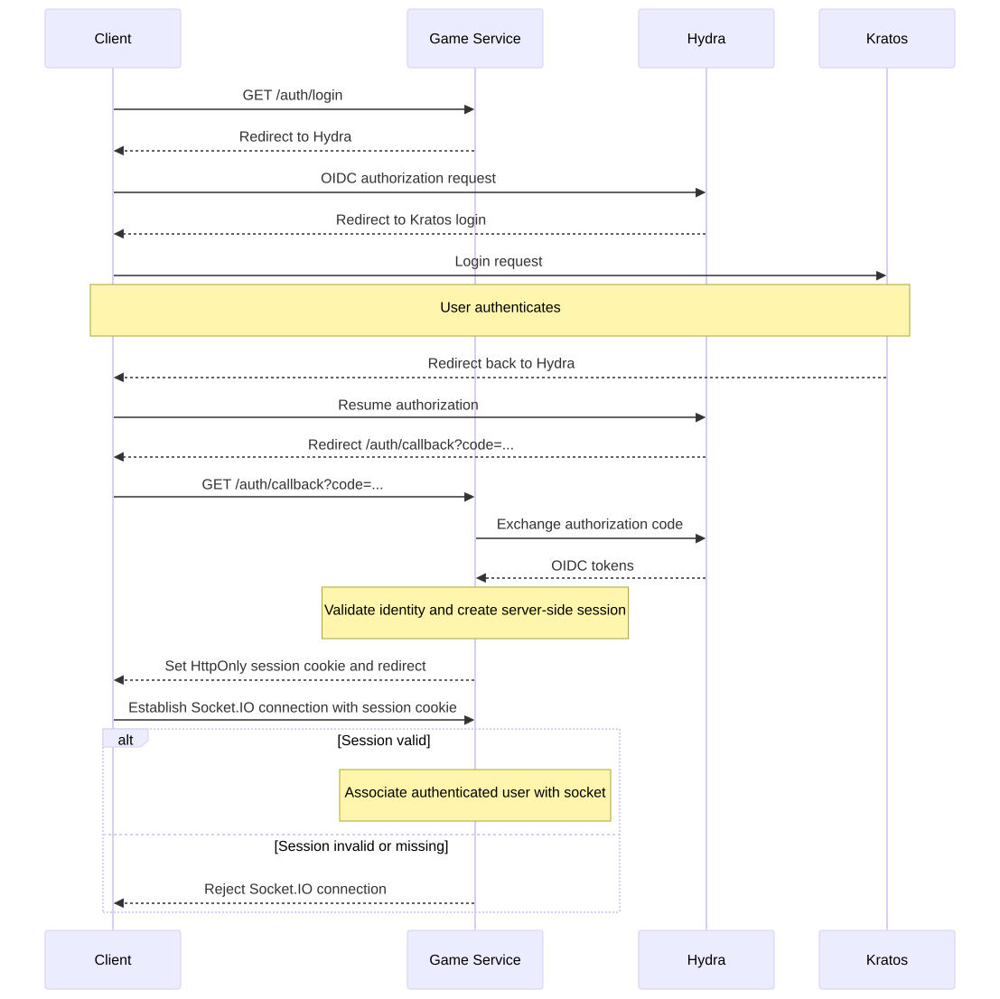
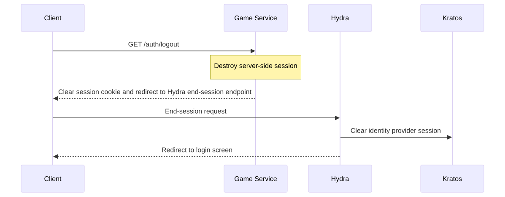
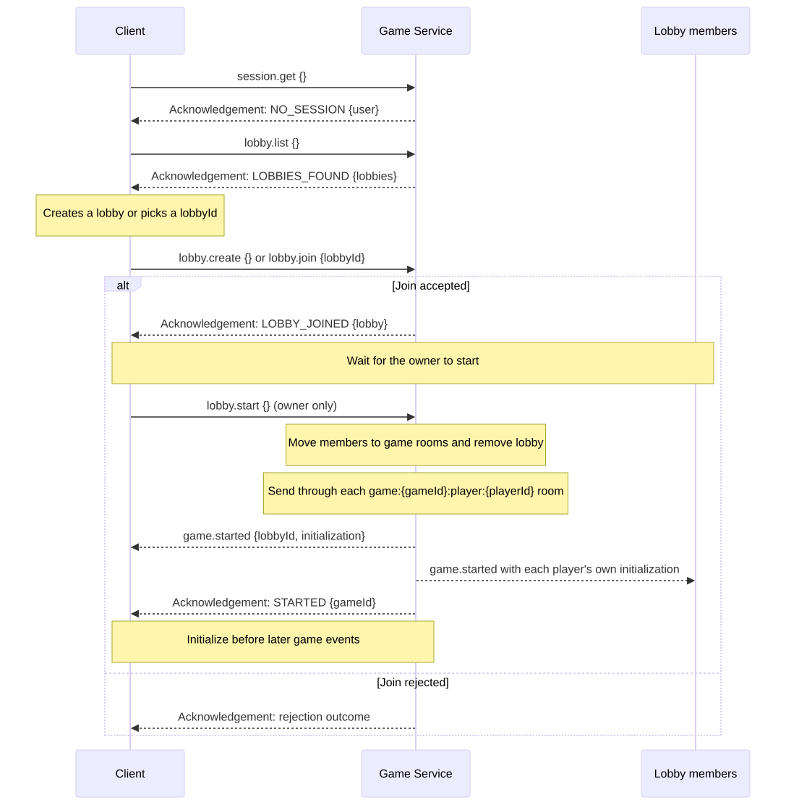
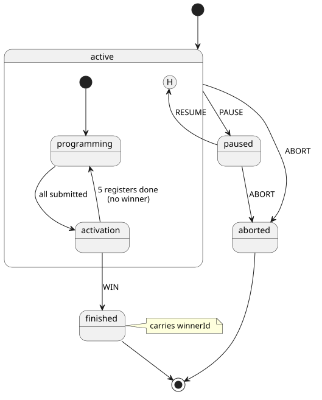
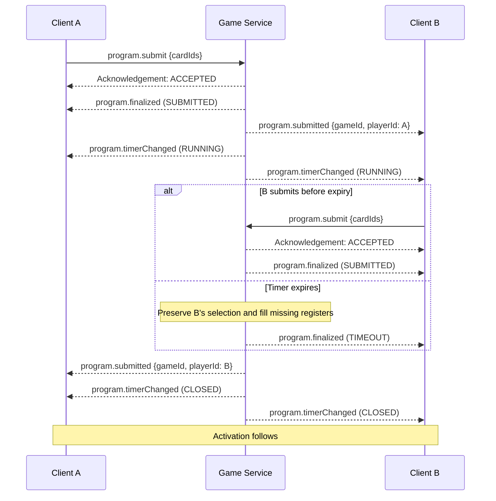
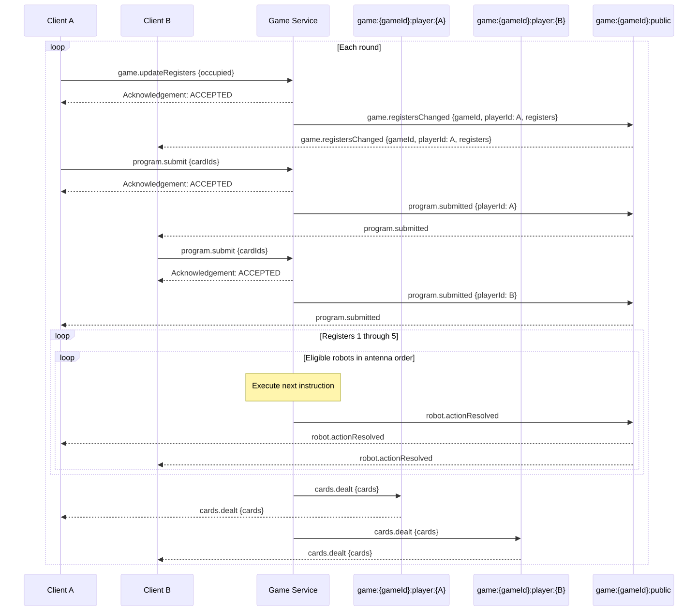
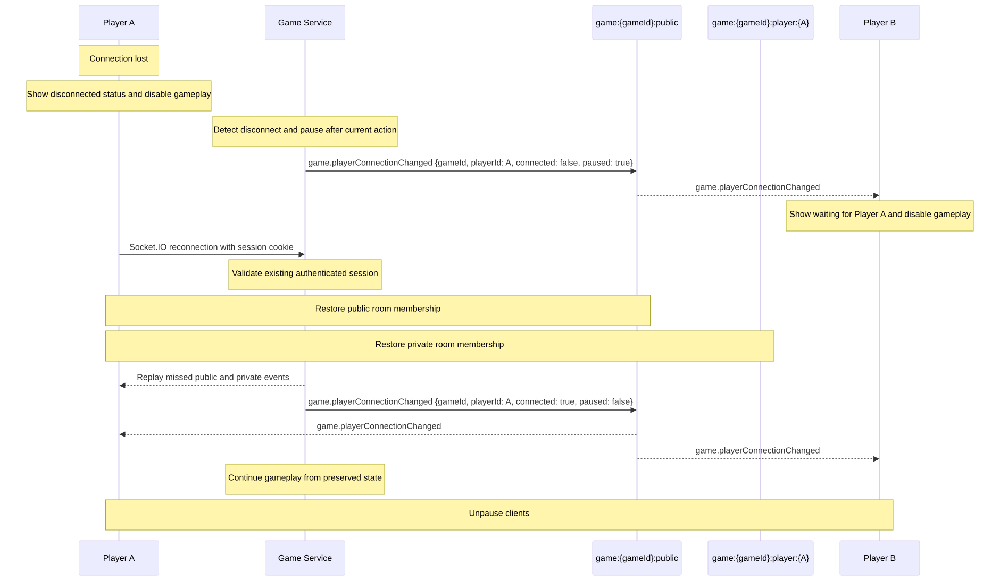
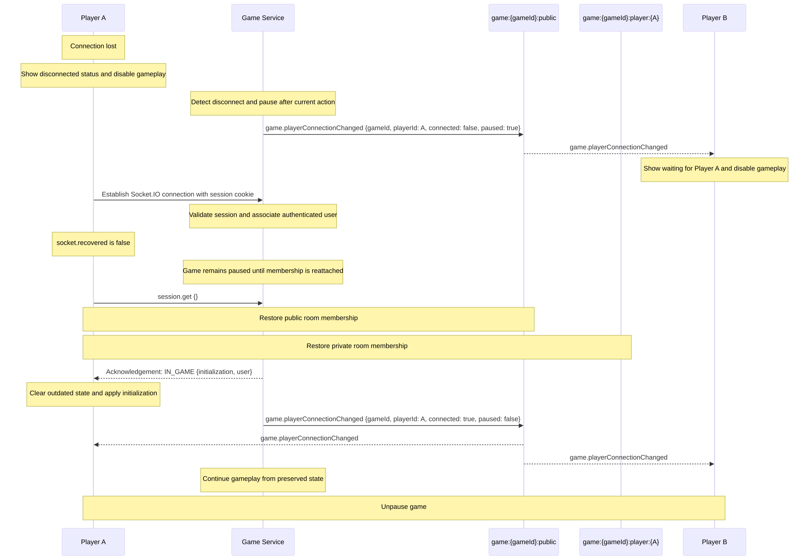

# Communication
The Client and Game Service use Socket.IO to communicate with each other. 
Client requests receive acknowledgement callbacks. Game state changes and gameplay updates are delivered as events.

This document describes the v1.2.0 communication flow. [AsyncAPI](asyncapi.yaml) defines the exact payloads and rejection codes, with a [rendered reference](asyncapi.html).

## Rooms

Server side Socket.IO rooms scope event broadcasts to only the connections that should receive them. The service uses three kinds:

- `lobby:{lobbyId}` — every connection currently waiting in that lobby. Carries lobby-wide updates such as `lobby.updated`, sent whenever membership or ownership changes.
- `game:{gameId}:public` — every connection currently a member of that game. Carries events every player needs to see: resolved robot actions, checkpoint progress, connection and pause state, and the fact that another player has submitted their program for the round.
- `game:{gameId}:player:{playerId}` — only the connection currently attached to that player. Carries anything that must stay private to that player (eg. their hand of cards).

Rooms are constructed server side. Clients never request to join a room directly — the server only calls `socket.join()` after validating a request, such as confirming a connection's game membership. This is what keeps the private player room private: there is no client-facing operation that could attach a socket to another player's room and expose private details such as their hand.

## Authentication
Authentication is handled using OpenID Connect (OIDC) with Hydra. The Game Service acts as the Backend for Frontend (BFF): instead of giving the browser an access token directly, it maintains the authenticated session itself. Passwords, Access and ID tokens never reach client-side JavaScript. The browser only ever holds a Secure, HttpOnly session cookie, which scripts cannot read even if an attacker manages to inject code into the page (XSS).

When the user is not authenticated, the browser starts login through the Game Service. The Game Service redirects the browser to Hydra, which redirects to Kratos for the user to authenticate, then completes the OIDC Authorization Code flow. After successful authentication, the Game Service creates a server-side session and returns a Secure, HttpOnly session cookie to the browser.

When the client establishes a Socket.IO connection, the browser includes the session cookie in the connection handshake. The Game Service validates the session before accepting the connection and associates the authenticated user with the socket. Unauthenticated Socket.IO connections are rejected.

An authenticated Socket.IO connection is not only checked at connect time. The Game Service re-validates the session on every command the client sends, and again before every broadcast to that socket, disconnecting it immediately if the session has since expired.

To avoid triggering that disconnect during normal play, the Game Service silently renews sessions using a refresh token obtained at login, refreshing the access token shortly before it expires. Renewal only happens when activity triggers a session check; an idle session is not refreshed and simply expires. Because a long-lived Socket.IO connection cannot receive a fresh `Set-Cookie`, the session cookie's lifetime tracks the refresh token's TTL rather than the access token's — by default 24 hours — which caps how long continued activity can keep a session alive before the user must log in again.

The following diagram documents session renewal:

Source: [figures/session-renewal.mmd](figures/session-renewal.mmd)

The following diagram documents authentication:

Source: [figures/auth-login.mmd](figures/auth-login.mmd)

### Logout

To log out, the client sends `GET /auth/logout` to the Game Service. The Game Service destroys the server-side session — discarding its refresh token, so the session cannot be silently renewed afterward — and clears the session cookie, then redirects the browser to Hydra's end-session endpoint to terminate the identity provider session as well. Hydra redirects back to the login screen once its session has been cleared.

Source: [figures/auth-logout.mmd](figures/auth-logout.mmd)

## Lobby
After successful authentication, the client sends a `session.get` request to determine if the user has an existent session. 
If he does not, `session.get` acknowledges with `NO_SESSION {user}` and the client is shown the lobby screen.

If a listed player disconnects before Start, `LOBBY_MEMBER_DISCONNECTED` leaves the lobby intact; the owner can retry after membership updates.

### Listing lobbies
The client then requets a list of existant lobbies via

`lobby.list`

A successful request returns:

`LOBBIES_FOUND {lobbies}`

From there the user has two options, creating a lobby or joining a lobby.

### Creating a lobby
The client sends `lobby.create`. As of this version there are no options and the server just assigns values for name and map. The creator becomes the lobbies owner. 

### Joining a lobby
Alternatively, the user can join an existing lobby. Once a lobby has been selected, the clients sends `lobby.join {lobbyId}`. 

### Starting a game
Both `lobby.join` and `lobby.create` acknowledge with `LOBBY_JOINED {lobby}` after which the client enters the waiting screen. All non owner users, then wait for the owner to start the game via `lobby.start {}`. 

Once a game has successfully started , the onber receives `STARTED {gameId}` as the command acknowledgement. How the game is initialised is described in [Initialization](#initialization).

### Lobby Membership
`LOBBY_JOINED`, `IN_LOBBY`, and `lobby.updated` include the full `lobby.players` roster (`userId`, `username`) in join order. Clients replace their roster on each snapshot; `lobby.list` returns summaries only.

While waiting, `lobby.leave {}` or disconnecting removes membership. Leaving returns `LEFT`. Ownership passes to the earliest remaining member, announced to the [lobby room](#rooms) through `lobby.updated {lobby}`. An empty lobby is deleted. A disconnected lobby member returns to browsing after reconnecting.

The following diagram documents the lobby lifecycle:

Source: [figures/lobby-lifecycle.mmd](figures/lobby-lifecycle.mmd)

## Game has started
### Game lifecycle
A game is always in one lifecycle state: `active`, `paused`, `aborted`, or `finished`. While the game is `active` it can be in one of these phases: `programming` or `activation`. A phase only exists while the game is active. Pausing does not clear the current phase, it is remembered and restored once the game resumes.

The diagram below shows every state and every transition between them:

- **`programming` → `activation`**, once every player has submitted their program. See [Programming](#programming).
- **`activation` → `programming`**, once all five registers have resolved and no robot has won. See [Dealing the next hand](#dealing-the-next-hand).
- **`active` → `finished`**, when a robot completes the final checkpoint. See [Winning](#winning).
- **`active` → `paused`**, when a player disconnects. See [Pausing on disconnection](#pausing-on-disconnection).
- **`paused` → `active`**, once every disconnected player has reconnected. The game resumes in the same phase it paused in. See [Restoring the connections](#restoring-the-connections).
- **`active` or `paused` → `aborted`**, on an unrecoverable service failure. See [Aborting](#aborting).

`aborted` and `finished` are final: once a game reaches either one, it does not change state again.

### Initialization
The service creates a fresh game, moves every member into its public and private player rooms, and removes the lobby room and record. The service sends each player the following through their own `game:{gameId}:player:{playerId}` room:

`game.started {lobbyId, initialization: {outcome: JOINED, assignment, state, hand, programSubmitted}}`

`state` includes `serverTime` and `programmingTimer`. The private `program` contains five register slots, each a card or `null`. Initialization restores the player's current selection or finalized program.

Each map has six starting tiles. When the game starts, the service places every robot on a random free starting tile.

### Programming
During the programming phase, each player submits five distinct card IDs in register order for the current round.

The client sends:

`program.submit {cardIds}`

A successful submission receives:

`ACCEPTED`

The server then emits:

`program.submitted {gameId, playerId}`

to the [public room](#rooms).

This announces that the player's program is finalized. The service also sends the five cards privately through `program.finalized`, with `reason: SUBMITTED`.

### Public registers

`PlayerState.registers` holds five slots in register order. `{status: EMPTY}` means no card is placed, `{status: HIDDEN}` means a card is placed without exposing its identity, and `{status: REVEALED, instruction}` shows an already-executed register. EMPTY and HIDDEN carry only their status. Each player's hand stays private.

While programming, the client sends `game.updateRegisters {cardIds}` with its current register selection. Each of the five entries is a card ID or `null` for an empty slot. Sending the selected IDs lets the service preserve assigned cards when time expires.

The service acknowledges the update and broadcasts `game.registersChanged {gameId, playerId, registers}` with HIDDEN and EMPTY slots. The private selection is also included in `game.started` and `session.get`.

`NOT_A_MEMBER` rejects a connection without valid transport ownership of the game and player; `PLAYER_NOT_IN_GAME` reports that the resolved player is absent from the domain game's roster. `GAME_PAUSED`, `GAME_ABORTED` and `GAME_FINISHED` report the corresponding lifecycle state rather than `WRONG_PHASE`. Rejected lifecycle updates do not mutate registers or broadcast `game.registersChanged`.

The client reveals a slot from `robot.actionResolved`, which carries `playerId`, `registerIndex` and `instruction`. `game.started` and `session.get` include every player's registers, revealed slots included, until the next hand resets them to five EMPTY slots.

### Programming timer

The first accepted `program.submit` starts a shared 30-second countdown. The service broadcasts:

`program.timerChanged {gameId, serverTime, timer}`

`serverTime` and `deadline` are Unix timestamps in milliseconds. `PublicGameState.programmingTimer` contains the same timer state.

An authenticated connection can send `clock.get {}` to obtain `CLOCK {serverTime}`
through its acknowledgement. The service reads the timestamp immediately before
sending the reply, allowing clients to measure a round trip and estimate the
server clock. No lobby or game membership is required. Invalid payloads receive
`INVALID_REQUEST`; the request does not change game state or broadcast events.

When a RUNNING timer arrives or a connection resumes, the client samples `clock.get`,
recording `sentAt` and `receivedAt` with `performance.now()`. In the reply callback,
it estimates `midpoint = sentAt + (receivedAt - sentAt) / 2` and anchors
`localDeadline = midpoint + (deadline - serverTime)` using the reply's timestamp.
The display counts down from `localDeadline - performance.now()`, independently of
timer-event delivery, rendering delays and the browser's wall clock. The midpoint
assumes similar travel times in both directions; the server enforces the deadline.
Old connection or timer replies are ignored. A failed sample keeps an existing
estimate; without one, the numeric countdown stays hidden until a sample succeeds.

| State | Payload | Meaning |
|---|---|---|
| Idle | `{status: IDLE}` | Waiting for the first submission. |
| Running | `{status: RUNNING, deadline}` | Programming is open until the deadline. |
| Closed | `{status: CLOSED}` | Programming has ended. |

When all players submit or the deadline expires, the service finalizes the programs. At expiry, it preserves accepted register selections and fills missing slots. Each affected player receives `program.finalized {gameId, playerId, reason: TIMEOUT, cards}` privately and replaces their selection with the returned five cards.

For both submission and timeout, the public room receives `game.registersChanged` with five HIDDEN slots and `program.submitted`. The service sends finalization events before the CLOSED timer event, followed by activation events. Further programming requests receive `WRONG_PHASE`.

On reconnect, the service sends the current timer with a fresh `serverTime`; `session.get` includes the timer and the player's private program. The existing [reconnection flow](#game-membership) applies.

A disconnect pauses gameplay without extending the programming deadline. At expiry, the service finalizes programs and sends CLOSED; activation waits until all remaining members are connected.

#### Timer sequence

This sequence shows the timer messages for two players. Public register updates and activation are described in their own sections.

### Activation

Once all remaining players have finalized programs, the service resolves the five registers in order. Within each register, eligible robots act according to antenna priority. Priority is recalculated after each robot action before the next robot acts.

Each resolved action is emitted to the [public room](#rooms) as:

`robot.actionResolved`

Clients must process resolved actions in the order in which they are received.

The event carries `playerId`, `registerIndex` and `instruction`, so each client reveals that player's register as the action plays.

A movement card can push a chain of robots. A wall or the antenna blocks the whole step. Pushed robots keep their facing direction and pending actions.

Movement resolves one square at a time. Robots entering pits or leaving the board reboot at once. The move stops if the acting robot reboots. A pushed robot rebooting does not stop it.

The event includes final positions after reboots: `position` for the acting robot and `pushedRobots` for other robots whose positions changed. Clients apply them together when the action plays.

#### Activation ordering

The antenna is located at the top centre of the board and faces south.

The test board uses:

- position (10, 0)
- direction Math.PI / 2

Robots cannot enter the antenna square.

The priority algorithm calculates the activation order based on the game rules.

### Checkpoint progress
Some tiles hold checkpoints. The demo board places checkpoint 1 at `(10, 6)` and checkpoint 2 at `(8, 9)`.

The CHECKPOINTS step reports progress from each robot’s final position. The client applies it after the register’s robot actions have played.

### Winning
A player wins when their robot completes the final checkpoint, so `lastCheckpoint` reaches `checkpointCount`. Like every checkpoint, this is checked at the end of a register. Robots cannot share a space, so only one robot can win. A board without checkpoints has no winner.

This is the `active` → `finished` transition, and it is final. The game ends at once: remaining registers are not resolved and no new hand is dealt. The service broadcasts to the [public room](#rooms):

`game.won {gameId, playerId, username}`

The event follows the final `environment.stepResolved`. `PublicGameState.winner` holds the winner's `{playerId, username}`, or `null` while the game runs, so reconnecting players also see the result. The service records the username when the game is won, so it is still sent after the winner has left.

After a win, `program.submit` is rejected with `GAME_FINISHED`. Players leave with `game.leave`, and the game is removed when the last member leaves.

The client shows the winner once the remaining actions have played, with a button to leave the game.

### Aborting
If the service hits a failure it cannot recover from, the game moves straight to `aborted`, from either `active` or `paused`. This is a safety mechanism and not an expected part of play like winning or pausing. Like winning it is game ending and permanent.

The server broadcasts this to the [public room](#rooms) with `game.aborted {gameId}`. See [Errors and rejections](#errors-and-rejections) for the full payload.

### Dealing the next hand

After all five registers have been resolved, the service deals each player a private hand for the next programming round. This is the `activation` → `programming` transition.

Each player receives:

`cards.dealt {gameId, playerId, cards}`

through the player's [private room](#rooms).

A new hand may arrive while the client is still playing animations from the previous activation. The client stores the new hand immediately and enables programming after queued resolved actions have finished playing. If another player starts the shared timer first, the client finishes that playback immediately so the hand becomes available.

The new hand also opens the next programming round, so the client resets every player's registers to five EMPTY slots when its own hand arrives. A player who reconnects after that point gets the reset registers from `session.get`.

The service sends each private hand before broadcasting `program.timerChanged` with `IDLE` for the new round. If the next round timer starts while a client is still playing the previous round, the client finishes queued actions immediately and makes the new hand available.

### Game sequence

The following sequence shows the general game flow while connected and unpaused. Timer and private finalization messages are shown in the [timer sequence](#timer-sequence).

Both players have received their initial hands through game.started or session.get.

Source: [figures/game-round.mmd](figures/game-round.mmd)

### Game Membership

A player's game membership and their authenticated session are both independent of their Socket.IO connection to the server. Losing the connection does not mean losing the player's spot in the game. When the connection is lost, the game is paused and the server rejects further gameplay submissions it receives. The client reflects this by indicating that it is disconnected and disables gameplay until the connection and game state have been restored.

A membership can only be owned by one live connection at a time: the first connection to reclaim it — whether through automatic Socket.IO recovery or an explicit `session.get {}` — becomes its owner, and a later connection attempting the same claim receives `USER_ALREADY_IN_SESSION` instead, leaving the authenticated session unaffected.

#### Pausing on disconnection
When the server detects that a player has disconnected, it pauses the game. This is the `active` → `paused` transition: no further action executes until the game resumes, including one that was already scheduled when the disconnect was detected. The current game state is preserved, including the current phase (`programming` or `activation`).

The server announces this to the [public room](#rooms):

`game.playerConnectionChanged {gameId, playerId, connected: false, paused: true}`

Currently, the game pauses whenever any client disconnects, regardless of the circumstances. This is being evaluated for changes in a future version: pausing unconditionally on every disconnect could be exploited to stall, and a more restrictive policy for when a disconnect actually triggers a pause may be introduced to prevent this kind of abuse (see issue #221).

#### Restoring the connections

After an unexpected connection loss, the client attempts to reconnect automatically through Socket.IO. If Socket.IO can reestablish the connection, it will try to replay missed events through its [connection state recovery mechanism](https://socket.io/docs/v4/connection-state-recovery).

There are two possible outcomes:

1. Connection state recovery succeeds and missed events are replayed.
2. Connection state recovery fails, so the client establishes a new authenticated Socket.IO connection and calls `session.get` to obtain a fresh authoritative snapshot.

##### Successful connection state recovery 
If recovery succeeds, Socket.IO replays the missed events. The client applies them in order on top of its retained local game state.

After connection recovery, a client with an unacknowledged or failed register save requests `session.get` before enabling programming. It restores the authoritative private selection or finalized program from that snapshot.

Source: [figures/reconnect-recovery-success.mmd](figures/reconnect-recovery-success.mmd)

##### Failed connection state recovery
If state recovery is unsuccessful, the client reinitializes by sending `session.get {}`, the same command used for normal game initialization. Because the user is already a game member, the server reattaches the connection to their existing player membership and returns the current authoritative state through `IN_GAME {initialization, user}`. The client replaces its local game state with this initialization before processing further game events.

Source: [figures/reconnect-recovery-failure.mmd](figures/reconnect-recovery-failure.mmd)

The game remains paused while any remaining player is disconnected. Once all remaining players are connected, the same `game.playerConnectionChanged` event (now with `paused: false`) announces that the game has resumed. This is the `paused` → `active` transition: the game resumes in the phase it was in before pausing, and gameplay continues from the preserved game state.

#### Leaving a game

An explicit `game.leave {}` removes the owning connection's player and robot, frees the occupied tile, and revokes its public/private room access. Remaining members receive `game.playerLeft {gameId, playerId, robotId}` through the [public room](#rooms). A disconnected player remains a member: disconnecting is not leaving.

## Errors and rejections

Most commands acknowledge failures with a specific outcome string rather than throwing. See [AsyncAPI](asyncapi.yaml), with a [rendered reference](asyncapi.html), for the exact payload shapes and the full set of rejection codes per command.

If an unexpected service failure makes gameplay unrecoverable, members receive `game.aborted {gameId}` through the [public room](#rooms), and the game ends permanently.

## Register-end environment

After each register's robot actions, the server resolves gears together, then
checks checkpoints before the next register or hand. Clients play
`environment.stepResolved` in order with robot actions.

The sequence starts at 1 and increases for every step, even empty ones. Socket.IO
recovery preserves playback. A fresh snapshot replaces playback and supersedes
results through `execution.lastEnvironmentSequence`.
