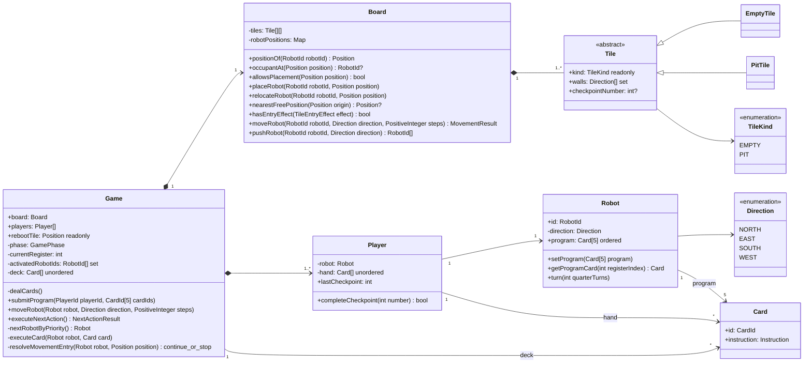

This UML Class diagram is to be used for internal development purposes. Such as planning what needs to be implemented and how. \
Will update with a more conceptual domain diagram which will be used for presentations highlighting parts of the model.



# Game

Game deals cards, accepts programs, and executes five registers. `submitProgram()` validates five distinct card IDs against the player's hand. Each action selects a pending robot using current Board positions and antenna priority. Movement uses `Game.moveRobot()`; turns change Robot's direction.

`Game.moveRobot(robot, direction, steps)` calls `Board.pushRobot()` one step at a time. After each successful step, it resolves entry effects for every displaced robot, farthest first. Blocked steps stop movement without an effect and preserve earlier successful steps. Entering a pit or leaving the board immediately reboots that robot through the same resolver. A pushed robot rebooting does not stop the initiating robot's remaining movement; the initiating robot rebooting does. Facing and programmed registers are preserved. Pushing does not mark the displaced robot as activated. Each programmed action reports the acting robot's final position and orientation before pending priority is recalculated.

Direct movement preserves orientation, programs, submissions, and register state. It neither starts a round nor marks an action complete, awards checkpoints, or emits events. Checkpoints are evaluated at final positions when all remaining robots finish a register, including when a departure completes it. Only the next numbered checkpoint counts; passing over one does not. After register five, Game returns to programming with progress preserved. Completing the course does not end the game.

# Board

Board owns the tile grid, antenna, and RobotId-to-Position map. `Board.moveRobot()` checks both sides of walls, the priority antenna, and robot occupancy, without executing tile effects or pushing. The antenna square is impassable. An unblocked step off the board vacates the previous square, records the outside position, and stops spatial movement. Game resolves the reboot before another gameplay step or action.

`Board.pushRobot()` validates the complete chain before changing any positions. A wall on either side of any crossed boundary or the priority antenna blocks the whole step. Otherwise it moves the chain farthest first and returns the displaced robot IDs in that order. Board only changes positions; Game handles entry effects after the complete step. Gameplay displacement goes through Game's movement operation. Non-pushing Board movement remains available for future conveyors.

Placement, relocation, spawning, reboot configuration, and safe-destination search use `Board.allowsPlacement()` to check bounds, tile suitability, and exclusion of the antenna. Robot occupancy is checked separately. Pits remain enterable during movement. Relocation does not trigger entry effects. Every Game requires a valid reboot tile, including on maps without pits. Reboot search uses Manhattan distance, then top-to-bottom and left-to-right tie-breaking; enclosing walls do not exclude a destination.

# Tile

Tile is descriptive data with a readonly `TileKind`: EmptyTile uses `EMPTY`, and PitTile uses `PIT`. The exhaustive `tileDefinitions` table declares:

| Kind | `canOccupy` for placement/reboot | `entryEffect` |
| --- | --- | --- |
| `EMPTY` | true | absent |
| `PIT` | false | `reboot` |

Definitions contain no callbacks. Walls, optional checkpoint numbers, and future settings such as conveyor direction belong to instances. Board validates unique checkpoint numbers consecutive from 1 and derives their count. Checkpoints can coexist with walls without a separate subclass. Tiles hold neither robots nor activation logic.

## Extending tiles

1. Add a tile kind and subclass with its instance data.
2. Declare placement suitability and any entry effect in `tileDefinitions`.
3. Reuse an effect or extend `TileEntryEffect` and Game's exhaustive resolver. Leave collision logic and card interpretation generic.
4. Add map construction and, for public kinds, shared types, AsyncAPI, the board adapter, and rendering. The presenter serializes `tile.kind` directly.
5. Test placement, movement, effect timing, and presentation through public APIs.

Register-end effects need their own ordered phase when implemented. Conveyors and push panels remain unimplemented. Publishing all pushed robots' positions to clients is a separate integration step. Pit animations, damage, register cancellation, and direction selection remain deferred.

# Robot

Has an ID, its direction, and an ordered program of five cards. Game assigns the program through `setProgram()` and reads the card for each register. Robot does not know its position or which Tile it occupies.

# Player

Has an assigned Robot and an unordered hand of cards. A five-card program is submitted through Game rather than assigned directly to Robot.

# Cards

Each Card has an instance ID and an Instruction. The shared instruction catalog defines movement distances and quarter turns, and its keys define the Instruction type. Game interprets these effects through Board and Robot. Cards describe actions rather than executing themselves.

The client keeps labels and icons in one presentation map and uses the shared effect kind to choose animation timing.

A Player's hand and Game's deck are unordered Card collections. A Robot's program is an ordered list of five Cards. These are properties, not separate classes.

# Direction

Enum of `NORTH`, `EAST`, `SOUTH`, and `WEST` (cardinal indicating global/non-local directions). `Robot.direction` indicates where it faces (therefore a direction rather than an orientation). `Tile.walls` is a set of Directions indicating which sides have walls. Board checks both sides of a tile boundary when moving a robot or tracing a laser.

Later, directional board elements such as lasers or conveyor belts can use Direction too.


# Pseudocode to be used as inspiration for later implementations:

## Register execution:

```
# submitProgram enters activation once all players have submitted.
while game.phase == "activation":
    result = game.executeNextAction()             # Select next pending robot by current priority
    # Execute its card: Game.moveRobot resolves entries; Robot handles turning.
    # Mark this robot as activated and capture the final position after any reboot.
    # After the last robot: evaluate checkpoints and advance the register.
    # After the fifth register: clear programs and return to programming.
    # The socket layer publishes the action before associated checkpoint updates.
```

## Laser obstacle:

```
game.activateBoardElements():                     # Illustrative future laser phase; retain checkpoint checks
    for each (position, laser) on board:
        hit = board.firstRobotHit(position, laser.direction)
        if hit exists:
            game.damageRobot(hit)

board.firstRobotHit(position, direction):
    while board.isInBounds(position):
        if robotId = board.occupantAt(position):
            return robotId
        next = board.getNeighbour(position, direction)
        if not board.isInBounds(next):
            return none
        if board.hasWallBetween(position, direction):  # Wall on either side blocks the laser
            return none
        position = next
    return none
```

## Robot priority (TypeScript reference implementation):

Board stores the antenna. This reference function accepts it explicitly to show the priority calculation independently. Its `angle` is in radians from east; with board coordinates increasing south, positive angles rotate clockwise. Call this again after each robot acts, using only robots that have not activated in the current register. Exact ties keep the first ID in `remaining`.

```ts
type RobotId = string
type Position = Readonly<{ x: number; y: number }>
type Antenna = Readonly<Position & { angle: number }>
type BoardPositions = { positionOf(robotId: RobotId): Position }

function nextRobotByPriority(
  remaining: readonly RobotId[],
  board: BoardPositions,
  antenna: Antenna,
): RobotId {
  if (remaining.length === 0) {
    throw new RangeError('No robots remain to activate')
  }

  const fullTurn = 2 * Math.PI
  const score = (id: RobotId): readonly [number, number] => {
    const position = board.positionOf(id)
    const distance = Math.abs(position.x - antenna.x) + Math.abs(position.y - antenna.y)
    const angle = Math.atan2(position.y - antenna.y, position.x - antenna.x)
    const offset = ((angle - antenna.angle) % fullTurn + fullTurn) % fullTurn
    return [distance, offset]
  }

  return remaining.reduce((best, id) => {
    const [distance, offset] = score(id)
    const [bestDistance, bestOffset] = score(best)
    return distance < bestDistance || (distance === bestDistance && offset < bestOffset)
      ? id
      : best
  })
}
```
