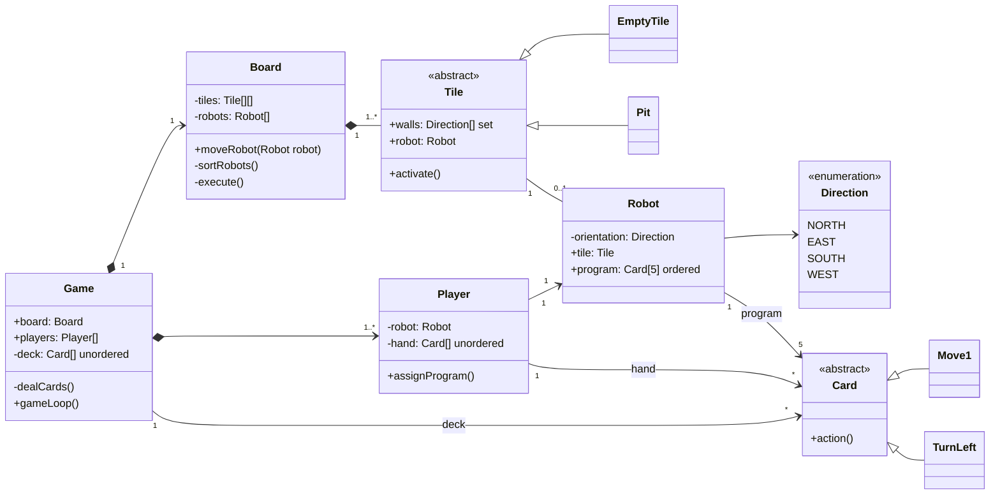

This UML Class diagram is to be used for internal development purposes. Such as planning what needs to be implemented and how. \
Will update with a more conceptual domain diagram which will be used for presentations highlighting parts of the model.



# Game

Responsible for dictating the game loop

# Board

Has the Tile grid and Robots \
(Not to be implemented in V0) Sorts robots based on the proximity antenna \
Executes robot programs \
Schedules tile activation

Should know implicitly where each Tile is. When tile executes stuff it only tells board which direction it wants to move stuff, board retains authority in actually moving things. 

Robot location is up for debate. I had the suggestion of storing robots as a tuple list of:
``` 
[( robot1: Robot, location1: (x: number, y: number)), ( robot2: Robot, location2: (x: number, y: number)), ...] 
```
This would make it really easy to sort the robots list based on proximity to the priority antenna, and calculations abt moving the robot, but society is not yet ready for solutions of such elegance. \
Board should have responsibility for keeping track of where everything is so I don't want to have references to location inside the Tile or Robot class.

# Tile

Abstract class that gets extended with each obstacle type  \
Outlines what it's execution does.  \
To be called directly when it's the type that activates even when a robot isn't on it, like a laser firing across the map stopping at the first robot or wall.  \
Only Pit is to be implemented in V0.

# Robot 

Passes it's program from Player to Board.  \
Used to find the tiles that activate when robot is on them, like a conveyor belt that moves the robot.


# Player 

Has robot assigned  \
Responsible for assigning a Program to their Robot

# Cards

Abstract class that gets extended with each card  \
Cards are moves the robots can execute

Players have an unordered list/set of Card[] referred to as a hand (only a variable, not a class)  \
Game has an unordered list/set of Card[] referred to as a deck (only a variable, not a class)  \
Robot has an ordered list of Card[5] referred to as a program (only a variable, not a class)

# Direction

Enum of orientations  \
Robot has simple orientation indicating where it's facing.  \
Tile has a set of Direction[] indicating which sides have walls (useful for collision/path blocking detection).

Later some Tiles will also use it such as laser or conveyor belt (OrientedTile abstract class will extend tile with an additional orientation variable)


# Pseudocode to be used as inspiration for later implementations:

## Board:

```

for register
    board.getpriolist() -> []robots
        executeRegisters(robots)               (executes 1 register for each robot, they have new positions after this)
        for robot:
            resolveBoardActionPhase 1-4
        shootBoardLasers()
        for robot:
            resolveBoardActionPhase 7-8

```

## Laser obstacle:


```

activate()
    o = this.orientation
    recurse(this, o)
        if this.robot                       # 1: is there a robot on my tile?
            damage(robot)
            break
        if o in this.walls                  # 2: Does a wall block me from leaving this tile?
            break
        next_tile = board.getTile(o, 1)     # Get neighboiring tile in defined orientation, if edge of board is reached, board should fail this
        if ((o+2)%4) in next_tile.walls     # 3: Does a wall block me from entering next tile?
            break
        recurse(next_tile, o)               # 4: start over in next tile

```
