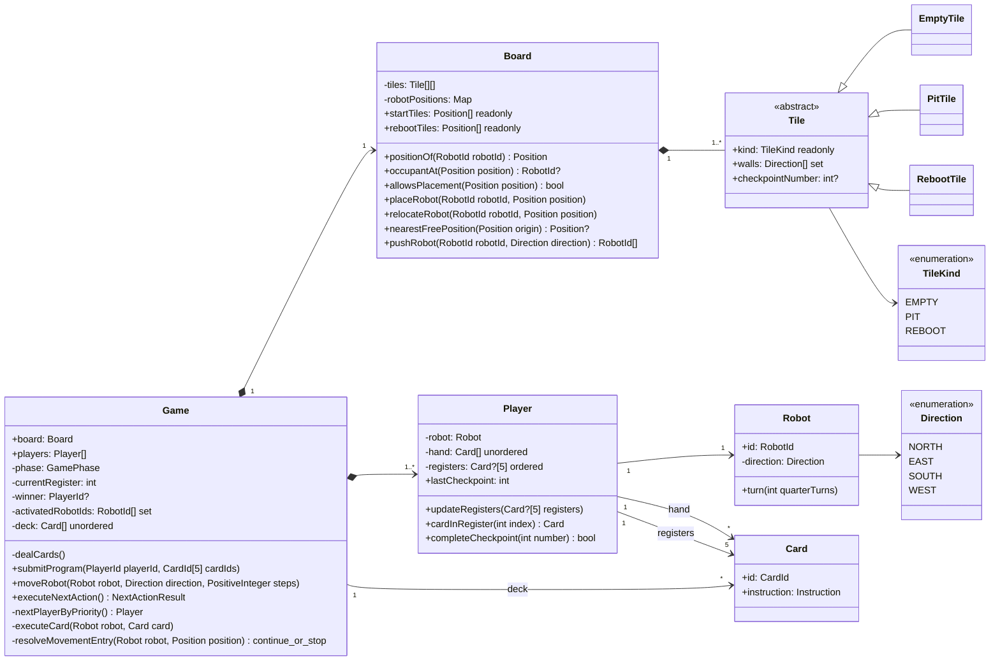

This UML Class diagram is to be used for internal development purposes. Such as planning what needs to be implemented and how. \
Will update with a more conceptual domain diagram which will be used for presentations highlighting parts of the model.



# Game

Game deals cards, accepts programs, and executes five registers. `submitProgram()` validates five distinct card IDs against the player's hand. Each action selects a pending robot using current Board positions and antenna priority. Movement uses `Game.moveRobot()`; turns change Robot's direction.

`Game.moveRobot(robot, direction, steps)` calls `Board.pushRobot()` one step at a time. After each successful step, it resolves entry effects for every displaced robot, farthest first. Blocked steps stop movement without an effect and preserve earlier successful steps. Entering a pit or leaving the board immediately reboots that robot through the same resolver. A pushed robot rebooting does not stop the initiating robot's remaining movement; the initiating robot rebooting does. Facing and programmed registers are preserved. Pushing does not mark the displaced robot as activated. Each programmed action reports the acting robot's final position and orientation before pending priority is recalculated.

After all remaining robots act, Game resolves gears together and checks each
robot's final tile for its next checkpoint. The final checkpoint ends the game.
Otherwise, register five ends the round and Game deals new hands.

# Board

Board owns the tile grid, antenna, and RobotId-to-Position map. It resolves one spatial movement step at a time without executing tile effects. The antenna square is impassable. Entering a pit or leaving the board records the robot's new position; Game resolves the reboot before another gameplay step or action.

`Board.pushRobot()` validates the complete chain before changing any positions. A wall on either side of any crossed boundary or the priority antenna blocks the whole step. Otherwise it moves the chain farthest first and returns the displaced robot IDs in that order. Board only changes positions; Game handles entry effects after the complete step. Gameplay displacement goes through Game's movement operation.

Placement, relocation, spawning, reboot configuration, and safe-destination search use `Board.allowsPlacement()` to check bounds, tile suitability, and exclusion of the antenna. Robot occupancy is checked separately. Pits remain enterable during movement. Relocation does not trigger entry effects. Reboot tiles are RebootTile instances in the grid; Board lists their positions as `rebootTiles`, top-to-bottom and left-to-right, and requires at least one, including on maps without pits. Each map defines four. A rebooting robot goes to the free reboot tile with the smallest Manhattan distance from where it fell, with ties kept in that order. If every reboot tile is occupied, the search falls back to the nearest free tile to the closest reboot tile, using Manhattan distance, then top-to-bottom and left-to-right tie-breaking; enclosing walls do not exclude a destination.

# Tile

Tile is descriptive data with a readonly `TileKind`: EmptyTile uses `EMPTY`, PitTile uses `PIT`, and RebootTile uses `REBOOT`. Tile subclasses declare placement suitability and entry effects.

| Kind | `canOccupy` for placement/reboot | `entryEffect` |
| --- | --- | --- |
| `EMPTY` | true | absent |
| `PIT` | false | `reboot` |
| `REBOOT` | true | absent |

Walls, optional checkpoint numbers, and future settings such as conveyor direction belong to instances. Board validates unique checkpoint numbers consecutive from 1 and derives their count. Checkpoints can coexist with walls without a separate subclass. Tiles hold neither robots nor activation logic.

## Extending tiles

1. Add a tile kind and subclass with its instance data.
2. Override placement suitability and any entry effect on the tile subclass.
3. Reuse an effect or extend `TileEntryEffect` and Game's exhaustive resolver. Leave collision logic and card interpretation generic.
4. Add map construction and, for public kinds, shared types, AsyncAPI, the board adapter, and rendering. The presenter serializes `tile.kind` directly.
5. Test placement, movement, effect timing, and presentation through public APIs.

Gears rotate during the register-end phase. Pits reboot on entry.

## Action playback

Each `NextActionResult` captures the acting robot and a `pushedRobots` list of other robots whose final positions changed during the card. These snapshots include completed reboots and remain independent of later movement. The presenter includes this list in the existing `robot.actionResolved` event; ordinary turns and blocked movements send an empty list.

Client playback applies the acting robot's result and all pushed results together when that queued action starts, preserving each robot's reported orientation and the existing card timing. A push does not create extra programmed actions. Departed robots are not recreated, and queued pushes to surviving robots are retained when the acting robot leaves.

## Pushing tests

Build and run the multiplayer push tests:

```sh
pnpm build
pnpm --filter @robo-rally/client exec playwright test --config playwright.membership.config.ts tests/pushing-multiplayer.e2e.ts
```

# Robot

Has an ID and its direction. Robot does not know its position or which Tile it occupies.

# Player

Has an assigned Robot, an unordered hand of cards, and five ordered register slots. A five-card program is submitted through Game, which writes it to the registers.

# Cards

Each Card has an instance ID and an Instruction. The shared instruction catalog defines movement distances and quarter turns, and its keys define the Instruction type. Game interprets these effects through Board and Robot. Cards describe actions rather than executing themselves.

The client keeps labels and icons in one presentation map and uses the shared effect kind to choose animation timing.

A Player's hand and Game's deck are unordered Card collections. A Player's registers are an ordered list of five slots, each holding one Card or nothing. These are properties, not separate classes.

# Direction

Enum of `NORTH`, `EAST`, `SOUTH`, and `WEST` (cardinal indicating global/non-local directions). `Robot.direction` indicates where it faces (therefore a direction rather than an orientation). `Tile.walls` is a set of Directions indicating which sides have walls. Board checks both sides of a tile boundary when moving a robot or tracing a laser.

Later, directional board elements such as lasers or conveyor belts can use Direction too.


# Pseudocode to be used as inspiration for later implementations:

## Register execution:

```
# submitProgram enters activation once all players have submitted.
while game is actively executing:
    publish(game.executeNextStep())  # Robot actions, gears, then checkpoints.
```

## Laser obstacle:

```
calculateLasers(stepStart):                       # Illustrative future step before checkpoints
    calculate every laser hit against stepStart
    return the resulting damage batch

board.firstRobotHit(position, direction):
    while board.isInBounds(position):
        if robotId = board.occupantAt(position):
            return robotId
        next = board.getNeighbour(position, direction)
        if not board.isInBounds(next):
            return none
        if board.hasWallBetween(position, direction):  # Wall on either side blocks the laser
            return none
        position = next
    return none
```

## Robot priority (TypeScript reference implementation):

Board stores the antenna. This reference function accepts it explicitly to show the priority calculation independently. Its `angle` is in radians from east; with board coordinates increasing south, positive angles rotate clockwise. Call this again after each robot acts, using only robots that have not activated in the current register. Exact ties keep the first ID in `remaining`.

```ts
type RobotId = string
type Position = Readonly<{ x: number; y: number }>
type Antenna = Readonly<Position & { angle: number }>
type BoardPositions = { positionOf(robotId: RobotId): Position }

function nextRobotByPriority(
  remaining: readonly RobotId[],
  board: BoardPositions,
  antenna: Antenna,
): RobotId {
  if (remaining.length === 0) {
    throw new RangeError('No robots remain to activate')
  }

  const fullTurn = 2 * Math.PI
  const score = (id: RobotId): readonly [number, number] => {
    const position = board.positionOf(id)
    const distance = Math.abs(position.x - antenna.x) + Math.abs(position.y - antenna.y)
    const angle = Math.atan2(position.y - antenna.y, position.x - antenna.x)
    const offset = ((angle - antenna.angle) % fullTurn + fullTurn) % fullTurn
    return [distance, offset]
  }

  return remaining.reduce((best, id) => {
    const [distance, offset] = score(id)
    const [bestDistance, bestOffset] = score(best)
    return distance < bestDistance || (distance === bestDistance && offset < bestOffset)
      ? id
      : best
  })
}
```
