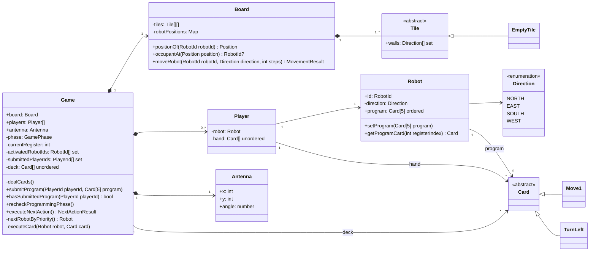

This UML Class diagram is to be used for internal development purposes. Such as planning what needs to be implemented and how. \
Will update with a more conceptual domain diagram which will be used for presentations highlighting parts of the model.



# Game

Game owns programming, activation, and register advancement.
It deals the fixed card supply to each player and accepts one five-card program
per player. Activation starts only when the nonempty roster has all submitted.
An empty game stays in programming. There is no timer.

`executeNextAction()` executes one robot and returns its action and zero-based
register index. Game recalculates priority from current Board
positions after every action. Every robot acts before the next register starts.
Board effects run after the last robot in a register; there are none in V0.
After register five, Game clears all programs and submission state, deals every
player's next hand, and returns to programming.

The service publishes each result before scheduling the next action. It sends
explicit phase events and private hands but does not count registers or decide
when activation starts. See [the communication guide](v0Communication.md) for
the fixed-roster integration hooks used by issues #68 and #69.

# Board

Has the Tile grid and keeps track of each Robot's position in a map from RobotId to Position. Tile and Robot do not hold references to one another.

Answers position and occupancy queries, and carries out movement. Board checks walls, board edges, and other robots before moving anything; pushing other robots can be resolved here later. Game reads Board positions and antenna state to work out priority, but Board does not sort robots or execute their programs.

# Tile

Abstract class describing what is on a board space. Walls are properties of any Tile, not a separate tile type. EmptyTile is currently the only tile type shown for V0.

Tiles do not hold robots or activate themselves. Game can schedule board effects later, with Board handling the spatial checks needed to find what they affect.

# Robot

Has an ID, its direction, and an ordered program of five cards. Game assigns the program through `setProgram()` and reads the card for each register. Robot does not know its position or which Tile it occupies.

# Player

Has an assigned Robot and an unordered hand of cards. A five-card program is submitted through Game rather than assigned directly to Robot.

# Cards

Abstract class that gets extended with each card type. `Move1` and `TurnLeft` are the V0 examples. Cards describe actions; Game interprets them instead of each card executing itself.

A Player's hand and Game's deck are unordered Card collections. A Robot's program is an ordered list of five Cards. These are properties, not separate classes.

# Direction

Enum of `NORTH`, `EAST`, `SOUTH`, and `WEST` (cardinal indicating global/non-local directions). `Robot.direction` indicates where it faces (therefore a direction rather than an orientation). `Tile.walls` is a set of Directions indicating which sides have walls. Board checks both sides of a tile boundary when moving a robot or tracing a laser.

Later, directional board elements such as lasers or conveyor belts can use Direction too.


# Pseudocode to be used as inspiration for later implementations:

## Action execution

The service schedules one action at a time so later membership handlers can run
between actions. It does not wait for client animation acknowledgements.

```
game.submitProgram(playerId, cards)             # Game checks the submission barrier
broadcast any resulting phase change
while game.phase == activation:
    result = game.executeNextAction()          # Game selects robot and advances registers
    broadcast result                           # Preserve this order for client playback
    broadcast any resulting phase change
    if game.phase == programming:
        send each player their private hand
    yield to the service event loop
```

## Laser obstacle:

```
game.activateBoardElements():                     # Later; no-op in V0
    for each (position, laser) on board:
        hit = board.firstRobotHit(position, laser.direction)
        if hit exists:
            game.damageRobot(hit)

board.firstRobotHit(position, direction):
    while board.isInBounds(position):
        if robotId = board.occupantAt(position):
            return robotId
        next = board.getNeighbour(position, direction)
        if not board.isInBounds(next):
            return none
        if board.hasWallBetween(position, direction):  # Wall on either side blocks the laser
            return none
        position = next
    return none
```

## Robot priority (TypeScript reference implementation):

Game stores a fixed, positioned antenna. Its `angle` is in radians from east;
with board coordinates increasing south, positive angles rotate clockwise.
The default is `(floor(width / 2), 0)` facing south, or `Math.PI / 2`.
Call the algorithm after each robot acts, using only robots that have not
activated in the current register. Exact ties keep roster order. The antenna
does not occupy a robot tile. The implementation scans once without allocating
score tuples; this reference illustrates the same ordering.

```ts
type RobotId = string
type Position = Readonly<{ x: number; y: number }>
type Antenna = Readonly<Position & { angle: number }>
type BoardPositions = { positionOf(robotId: RobotId): Position }

function nextRobotByPriority(
  remaining: readonly RobotId[],
  board: BoardPositions,
  antenna: Antenna,
): RobotId {
  if (remaining.length === 0) {
    throw new RangeError('No robots remain to activate')
  }

  const fullTurn = 2 * Math.PI
  const score = (id: RobotId): readonly [number, number] => {
    const position = board.positionOf(id)
    const distance = Math.abs(position.x - antenna.x) + Math.abs(position.y - antenna.y)
    const angle = Math.atan2(position.y - antenna.y, position.x - antenna.x)
    const offset = ((angle - antenna.angle) % fullTurn + fullTurn) % fullTurn
    return [distance, offset]
  }

  return remaining.reduce((best, id) => {
    const [distance, offset] = score(id)
    const [bestDistance, bestOffset] = score(best)
    return distance < bestDistance || (distance === bestDistance && offset < bestOffset)
      ? id
      : best
  })
}
```
