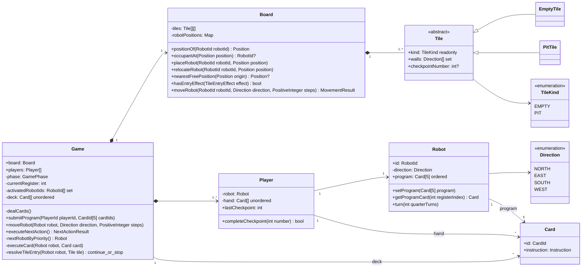

This UML Class diagram is to be used for internal development purposes. Such as planning what needs to be implemented and how. \
Will update with a more conceptual domain diagram which will be used for presentations highlighting parts of the model.



# Game

Responsible for dictating the game loop: dealing cards, taking programs, and executing their registers.

Keeps track of the current phase and register. `submitProgram()` checks five distinct card IDs against the player's hand before assigning their cards to the Robot. During activation, Game chooses the next robot from those that have not acted yet, using current positions on Board and the priority antenna. It reads that robot's card and applies it: movement uses `Game.moveRobot()`, while turns change Robot's direction. Priority is worked out again after each robot acts, using any completed reboot position.

`Game.moveRobot(robot, direction, steps)` is the shared gameplay movement operation. It asks Board to attempt one step, stops if blocked, and resolves the entered tile's declared effect after each successful step. The entry resolver returns `continue` or `stop`. A `reboot` effect relocates the robot immediately and stops the rest of that movement instruction. The resulting action contains the final position and unchanged orientation; spatial steps do not produce separate action results.

Direct callers can reuse this movement operation without submitting or executing a card. The caller chooses when movement happens: the operation does not start a round, consume a program card, advance a register, mark a robot as activated, award checkpoints, or emit network events. Existing program/submission state and orientation are preserved.

Board elements activate after the robot actions in each register. Game reads each remaining robot's final tile and asks its Player to complete that checkpoint. Player advances only to the next numbered checkpoint. Passing over one during movement does not count. This also runs when removing a player finishes a register. After the fifth register, Game returns to programming, preserving checkpoint progress; completing the course does not end the game.

# Board

Has the Tile grid and keeps track of each Robot's position in a map from RobotId to Position. Tile and Robot do not hold references to one another.

Answers position and occupancy queries, and carries out spatial movement. Board checks walls on both sides of each boundary, board edges, and other robots before moving anything. `Board.moveRobot()` does not execute entry effects or stop specifically at pits: gameplay callers use `Game.moveRobot()` so effects are resolved before another step. Future pushing may reuse Board's collision logic, but displaced robots must still pass through Game's movement and effect timing.

Initial placement, safe relocation, and nearest-free-position selection use each tile definition's `canOccupy` rule. Bounds and robot occupancy remain separate Board checks. Placement suitability does not restrict movement into a tile: entering a pit is necessary for its reboot effect to happen. Relocation validates its destination without resolving another entry effect. Reboot search uses Manhattan distance, breaking ties top to bottom and then left to right, even when walls enclose a candidate tile.

Game reads Board positions and antenna state to work out priority, but Board does not sort robots or execute their programs. `hasEntryEffect('reboot')` inspects tile definitions so Game can require a configured reboot destination for boards that need one.

# Tile

Abstract class describing what is on a board space. Every tile exposes a readonly `kind` from the domain `TileKind` union. The current classes are EmptyTile (`EMPTY`) and PitTile (`PIT`). Walls are properties of any Tile, not a separate tile type.

The exhaustively typed `tileDefinitions` table in `apps/game-service/src/game/Tile.ts` declares placement suitability and an optional entry effect:

| Kind | `canOccupy` for placement/reboot | `entryEffect` |
| --- | --- | --- |
| `EMPTY` | true | absent |
| `PIT` | false | `reboot` |

Definitions are descriptive data, with no callbacks or references to Game. Walls, checkpoint numbers, and future settings such as conveyor direction belong to tile instances.

An optional `checkpointNumber` is another Tile property. A positive number identifies a checkpoint; absence means no checkpoint. Board owns its position through the tile grid, validates unique consecutive numbering from 1, and derives the checkpoint count. Checkpoints do not require a separate tile subclass and can coexist with walls.

Tiles do not hold robots or activate themselves. Game resolves entry effects during movement and checks checkpoints after all remaining robots have acted in a register. Moving or rebooting onto a checkpoint does not award it immediately; the robot must still end the register there. Rebooting preserves checkpoint progress, orientation, and the program; later registers continue normally.

## Extending tiles

1. Add a domain tile kind and a Tile subclass with any required instance data. Keep existing tile classes; a new hierarchy or plugin framework is unnecessary.
2. Add its definition to `tileDefinitions`, declaring placement suitability and any entry effect. Existing effects can be reused directly.
3. If a new entry effect is required, add its value to `TileEntryEffect` and implement it in Game's exhaustive entry resolver. Return whether the current movement continues or stops. Collision logic and movement-card interpretation do not need tile-specific branches.
4. Construct the tile through `boardMaps.ts` and `BoardFactory.ts`. For a new publicly visible kind, update the shared tile-type union, AsyncAPI, the client's board adapter, and rendering as needed. The presenter serializes `tile.kind` directly; type checks keep domain and public kind unions aligned. The current refactor retains the existing `EMPTY`/`PIT` payloads.
5. Test observable movement and timing through `Game.moveRobot()` and card execution, plus placement, map construction, and public presentation where relevant. The existing coverage is in `Movement.test.ts`, `Pits.test.ts`, Board/Game tests, and presenter/socket tests under `apps/game-service/test`.

A tile that acts at register end should introduce its required ordered phase when implemented. Do not force register-end behavior into the entry resolver or add an unused dispatcher ahead of a concrete requirement. Conveyors and pushing still need their own scheduling and collision design.

Pit animations, damage, cancellation of remaining registers, direction selection, and board-edge falls remain future work. Board edges currently block movement. The internal refactor adds no socket events or payload fields; see [Pits and rebooting](Communication.md#pits-and-rebooting) for the public guarantees.

# Robot

Has an ID, its direction, and an ordered program of five cards. Game assigns the program through `setProgram()` and reads the card for each register. Robot does not know its position or which Tile it occupies.

# Player

Has an assigned Robot and an unordered hand of cards. A five-card program is submitted through Game rather than assigned directly to Robot.

# Cards

Each Card has an instance ID and an Instruction. The shared instruction catalog defines movement distances and quarter turns, and its keys define the Instruction type. Game interprets these effects through Board and Robot. Cards describe actions rather than executing themselves.

The client keeps labels and icons in one presentation map and uses the shared effect kind to choose animation timing.

A Player's hand and Game's deck are unordered Card collections. A Robot's program is an ordered list of five Cards. These are properties, not separate classes.

# Direction

Enum of `NORTH`, `EAST`, `SOUTH`, and `WEST` (cardinal indicating global/non-local directions). `Robot.direction` indicates where it faces (therefore a direction rather than an orientation). `Tile.walls` is a set of Directions indicating which sides have walls. Board checks both sides of a tile boundary when moving a robot or tracing a laser.

Later, directional board elements such as lasers or conveyor belts can use Direction too.


# Pseudocode to be used as inspiration for later implementations:

## Register execution:

```
# submitProgram enters activation once all players have submitted.
while game.phase == "activation":
    result = game.executeNextAction()             # Select next pending robot by current priority
    # Execute its card: Game.moveRobot resolves entries; Robot handles turning.
    # Mark this robot as activated and capture the final position after any reboot.
    # After the last robot: evaluate checkpoints and advance the register.
    # After the fifth register: clear programs and return to programming.
    # The socket layer publishes the action before associated checkpoint updates.
```

## Laser obstacle:

```
game.activateBoardElements():                     # Illustrative future laser phase; retain checkpoint checks
    for each (position, laser) on board:
        hit = board.firstRobotHit(position, laser.direction)
        if hit exists:
            game.damageRobot(hit)

board.firstRobotHit(position, direction):
    while board.isInBounds(position):
        if robotId = board.occupantAt(position):
            return robotId
        next = board.getNeighbour(position, direction)
        if not board.isInBounds(next):
            return none
        if board.hasWallBetween(position, direction):  # Wall on either side blocks the laser
            return none
        position = next
    return none
```

## Robot priority (TypeScript reference implementation):

Board stores the antenna. This reference function accepts it explicitly to show the priority calculation independently. Its `angle` is in radians from east; with board coordinates increasing south, positive angles rotate clockwise. Call this again after each robot acts, using only robots that have not activated in the current register. Exact ties keep the first ID in `remaining`.

```ts
type RobotId = string
type Position = Readonly<{ x: number; y: number }>
type Antenna = Readonly<Position & { angle: number }>
type BoardPositions = { positionOf(robotId: RobotId): Position }

function nextRobotByPriority(
  remaining: readonly RobotId[],
  board: BoardPositions,
  antenna: Antenna,
): RobotId {
  if (remaining.length === 0) {
    throw new RangeError('No robots remain to activate')
  }

  const fullTurn = 2 * Math.PI
  const score = (id: RobotId): readonly [number, number] => {
    const position = board.positionOf(id)
    const distance = Math.abs(position.x - antenna.x) + Math.abs(position.y - antenna.y)
    const angle = Math.atan2(position.y - antenna.y, position.x - antenna.x)
    const offset = ((angle - antenna.angle) % fullTurn + fullTurn) % fullTurn
    return [distance, offset]
  }

  return remaining.reduce((best, id) => {
    const [distance, offset] = score(id)
    const [bestDistance, bestOffset] = score(best)
    return distance < bestDistance || (distance === bestDistance && offset < bestOffset)
      ? id
      : best
  })
}
```
