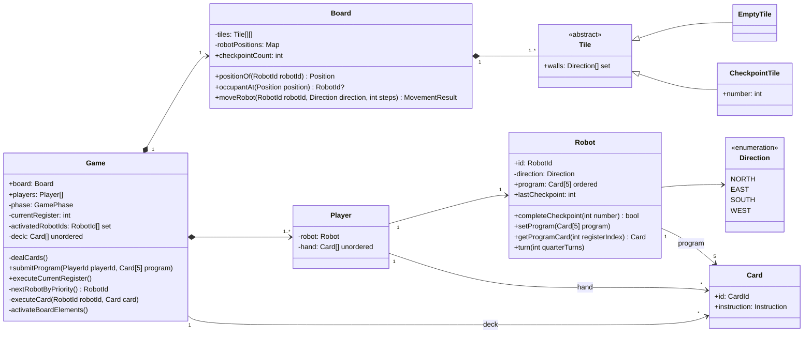

This UML Class diagram is to be used for internal development purposes. Such as planning what needs to be implemented and how. \
Will update with a more conceptual domain diagram which will be used for presentations highlighting parts of the model.

The checkpoint extension is proposed in [#129](https://github.com/hananinas/RoboRally/issues/129). Implementation belongs to [#123](https://github.com/hananinas/RoboRally/issues/123) after this design is approved.



# Game

Responsible for dictating the game loop: dealing cards, taking programs, and executing their registers.

Keeps track of the current phase and register. `submitProgram()` checks a player's five cards before assigning them to their Robot. During activation, Game chooses the next robot from those that have not acted yet, using current positions on Board and the priority antenna. It reads that robot's card and applies it: movement goes through Board, while turns change Robot's direction. Priority is worked out again after each robot acts.

Board elements activate after the robot actions in each register. This is currently a no-op; the proposed checkpoint extension uses this existing stage. After the fifth register, Game returns to the programming phase.

# Board

Has the Tile grid and keeps track of each Robot's position in a map from RobotId to Position. Tile and Robot do not hold references to one another.

Answers position and occupancy queries, and carries out movement. Board checks walls, board edges, and other robots before moving anything; pushing other robots can be resolved here later. Game reads Board positions and antenna state to work out priority, but Board does not sort robots or execute their programs.

# Tile

Abstract class describing what is on a board space. Walls are properties of any Tile, not a separate tile type. EmptyTile is currently the only tile type shown for V0.

Tiles do not hold robots or activate themselves. Game can schedule board effects later, with Board handling the spatial checks needed to find what they affect.

# Robot

Has an ID, its direction, and an ordered program of five cards. Game assigns the program through `setProgram()` and reads the card for each register. Robot does not know its position or which Tile it occupies.

# Checkpoints

`CheckpointTile` inherits Tile's walls and has a fixed positive integer `number`. Its position is its cell in Board's grid; it does not store a second position. Board validates that checkpoint numbers are unique and consecutive from 1 to `checkpointCount`. An empty checkpoint set is valid. Checkpoints remain on the board and are never consumed or assigned to a particular robot.

Each Robot starts with `lastCheckpoint = 0`. `completeCheckpoint(number)` advances it only when `number === lastCheckpoint + 1`, returning whether progress changed. Repeating or skipping a number leaves progress unchanged. Clearing a program or finishing a round does not reset progress. Disconnecting retains the same Robot and its progress; an explicit leave removes that Robot with the existing membership behavior.

At `activateBoardElements()`, Game checks the tile at every remaining robot's current Board position. A robot on its next checkpoint completes it, regardless of its facing or whether its card moved it. Passing over a checkpoint during a multi-step move does not count. Placing a robot or submitting a program does not complete a checkpoint. Each robot completes at most one checkpoint per register, independently of the others.

The existing `removePlayer()` path can finish a register when every remaining robot has acted. It must perform the same checkpoint check for the remaining robots. Game returns immutable completion records (`robotId`, `checkpointNumber`) from both execution paths, including the fifth register, for the service to publish. Transport events remain outside the domain.

The shared 21 by 15 board has checkpoint 1 at `(10, 6)` and checkpoint 2 at `(8, 9)`, using the existing top-left coordinate origin. These positions do not change the antenna or spawn row. The client displays `lastCheckpoint/checkpointCount` for its assigned robot, including `0/0` on a board without checkpoints. This proposal limits client presentation to that count; board markers and checkpoint animations are deferred.

Completing the final checkpoint leaves the existing programming/activation loop running. Winner selection, movement, antenna priority, hands, pause behavior, and membership rules are unchanged.

# Player

Has an assigned Robot and an unordered hand of cards. A five-card program is submitted through Game rather than assigned directly to Robot.

# Cards

Each Card has an instance ID and an Instruction. The shared instruction catalog defines movement distances and quarter turns, and its keys define the Instruction type. Game interprets these effects through Board and Robot. Cards describe actions rather than executing themselves.

The client keeps labels and icons in one presentation map and uses the shared effect kind to choose animation timing.

A Player's hand and Game's deck are unordered Card collections. A Robot's program is an ordered list of five Cards. These are properties, not separate classes.

# Direction

Enum of `NORTH`, `EAST`, `SOUTH`, and `WEST` (cardinal indicating global/non-local directions). `Robot.direction` indicates where it faces (therefore a direction rather than an orientation). `Tile.walls` is a set of Directions indicating which sides have walls. Board checks both sides of a tile boundary when moving a robot or tracing a laser.

Later, directional board elements such as lasers or conveyor belts can use Direction too.


# Pseudocode to be used as inspiration for later implementations:

## Register execution:

```
game.startActivationPhase()                     # currentRegister = 0
while game.currentRegister < 5:
    remaining = game.getActiveRobotIds()
    while remaining is not empty:
        robotId = game.getNextRobot(remaining)    # Uses current Board positions and antenna
        card = robot(robotId).getProgramCard(game.currentRegister)
        game.executeCard(robotId, card)           # Movement via Board, turning via Robot
        remaining.remove(robotId)                 # Priority is checked again for the next robot
    game.activateBoardElements()                  # Checkpoints; other ordered effects later
    game.finishRegister()                         # Advance to the next register
game.finishRound()                                # Return to programming phase
```

## Laser obstacle:

```
game.activateBoardElements():                     # Later; no-op in V0
    for each (position, laser) on board:
        hit = board.firstRobotHit(position, laser.direction)
        if hit exists:
            game.damageRobot(hit)

board.firstRobotHit(position, direction):
    while board.isInBounds(position):
        if robotId = board.occupantAt(position):
            return robotId
        next = board.getNeighbour(position, direction)
        if not board.isInBounds(next):
            return none
        if board.hasWallBetween(position, direction):  # Wall on either side blocks the laser
            return none
        position = next
    return none
```

## Robot priority (TypeScript reference implementation):

The antenna is passed explicitly because the current Board model does not store it yet. Its `angle` is in radians from east; with board coordinates increasing south, positive angles rotate clockwise. Call this again after each robot acts, using only robots that have not activated in the current register. Exact ties keep the first ID in `remaining`.

```ts
type RobotId = string
type Position = Readonly<{ x: number; y: number }>
type Antenna = Readonly<Position & { angle: number }>
type BoardPositions = { positionOf(robotId: RobotId): Position }

function nextRobotByPriority(
  remaining: readonly RobotId[],
  board: BoardPositions,
  antenna: Antenna,
): RobotId {
  if (remaining.length === 0) {
    throw new RangeError('No robots remain to activate')
  }

  const fullTurn = 2 * Math.PI
  const score = (id: RobotId): readonly [number, number] => {
    const position = board.positionOf(id)
    const distance = Math.abs(position.x - antenna.x) + Math.abs(position.y - antenna.y)
    const angle = Math.atan2(position.y - antenna.y, position.x - antenna.x)
    const offset = ((angle - antenna.angle) % fullTurn + fullTurn) % fullTurn
    return [distance, offset]
  }

  return remaining.reduce((best, id) => {
    const [distance, offset] = score(id)
    const [bestDistance, bestOffset] = score(best)
    return distance < bestDistance || (distance === bestDistance && offset < bestOffset)
      ? id
      : best
  })
}
```
