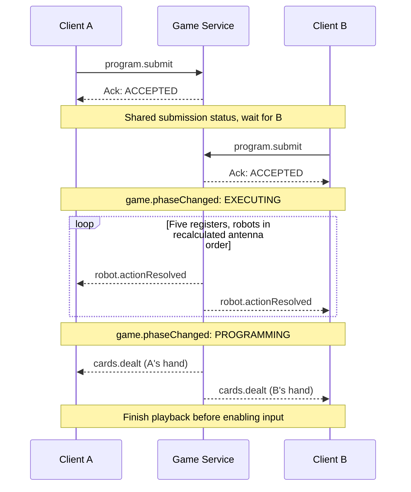

# Communication in v0.5

**Draft for review.** Message names and unfinished payloads are proposed, not implemented.
See [the contract](asyncapi.yaml) or [rendered reference](asyncapi.html) for details;
[the v0 guide](v0Communication.md) describes the current implementation.

## The flow

1. Enter a username of **1–30 characters**, without trimming or character restrictions.
   The service finds or creates the user and returns their identity.
2. Send a separate join request for the configured game. Receive a player/robot
   assignment, public state, and private hand together. Future lobby selection fits here,
   between login and joining.
3. Submit five ordered cards. The service checks ownership and waits for all players.
4. Execute five registers, with every robot acting in antenna order within each register.
   Send results immediately; clients play them in order before enabling the next hand.

There is no lobby phase, host, player cap, or timer. Players can join and leave at any
point; exactly how this affects an ongoing round still needs agreement.

## Messages

Requests use acknowledgement callbacks; replies are not separate emitted events.

| Request | Sends → receives |
| --- | --- |
| `user.login` | Username → user identity, never a player/robot |
| `game.join` | Game ID → assignment, public state, private hand |
| `game.leave` | Game ID → leave result |
| `game.getPublicGameState` | Game ID → snapshot; reading does not join |
| `program.submit` | Game ID, player ID, five card IDs → accepted/rejected |

The game room receives `game.playerJoined`, `game.playerLeft`, `program.submitted`,
`game.phaseChanged`, and `robot.actionResolved`. Exact recipients and payloads still
need review. `cards.dealt` goes only to the player's private room; hands and submitted
cards are never public.

## Proposed round

Both clients have logged in and joined separately before this sequence starts.

## Things we need to get right

- The connection's approved identity determines ownership; don't trust a supplied player ID.
- Apply join initialization before later updates without losing events. Repeated joins
  must not create duplicate players or notifications.
- Accepted submission does not mean activation has started. Use explicit phase updates.
- Rejections leave accepted state unchanged. Timeouts may have an unknown outcome;
  agree retry behavior before automatically resending.

## Still to agree

- User storage lifetime, ID format, Unicode counting, and simultaneous logins under one username.
- Mid-round joins, leaving/disconnecting (including the last player), repeated leaves,
  and whether login survives leaving or a rejected join.
- What happens when there is no available spawn tile, without leaving a partial assignment.
- Reply outcomes, snapshot contents/access, update recipients, and context needed for queued events.
  Resolve legacy `WAITING`; wire `EXECUTING` means domain activation.

Agree these with [#70](https://github.com/hananinas/RoboRally/issues/70), then finish the
YAML TODOs, add success/failure examples, validate, and regenerate the HTML. Runtime
implementation stays in [#65](https://github.com/hananinas/RoboRally/issues/65),
[#69](https://github.com/hananinas/RoboRally/issues/69),
[#68](https://github.com/hananinas/RoboRally/issues/68), and
[#67](https://github.com/hananinas/RoboRally/issues/67).
