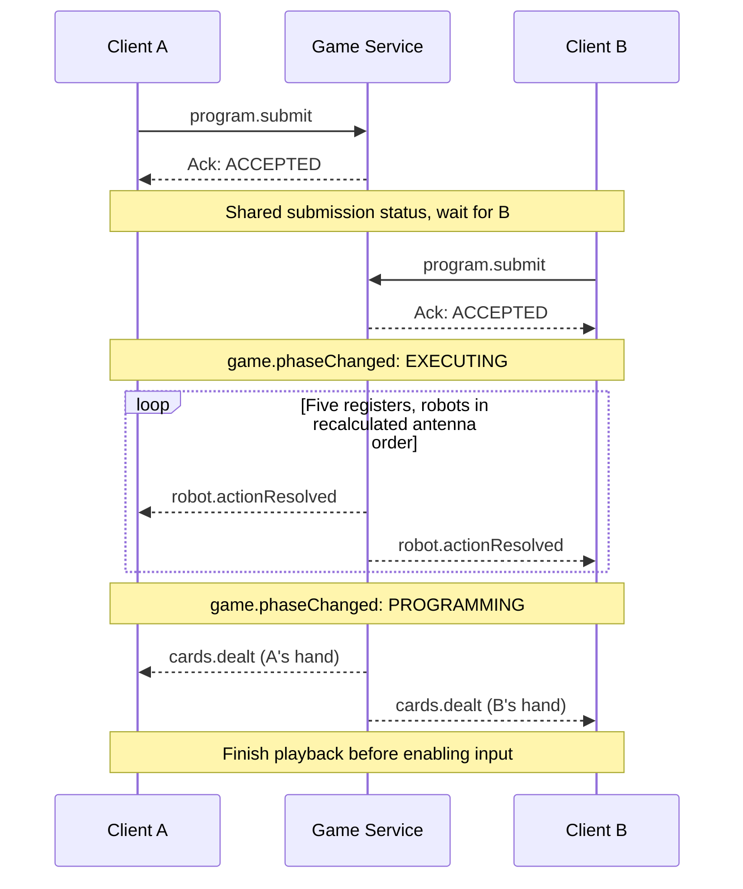

# Communication in v0.5

**Draft for review.** Login/join behavior below is specified for the entry screen.
Other unfinished messages are still proposals; runtime implementation follows separately.
See [the contract](asyncapi.yaml) or [rendered reference](asyncapi.html) for details;
[the v0 guide](v0Communication.md) describes the current implementation.

## The flow

1. Enter a username of **1–30 characters**, without trimming or character restrictions.
   The service finds or creates the user and returns their identity.
2. Send a separate join request for the configured game. Receive a player/robot
   assignment, public state, and private hand together. Future lobby selection fits here,
   between login and joining.
3. Submit five ordered cards. The service checks ownership and waits for all players.
4. Execute five registers, with every robot acting in antenna order within each register.
   Send results immediately; clients play them in order before enabling the next hand.

There is no lobby phase, host, player cap, or timer. Players can join and leave at any
point. Joining during programming counts toward that round. Joining during activation
places the robot but it sits out that activation, receives `hand: []`, and gets its
first `cards.dealt` when programming starts.

## Messages

Requests use acknowledgement callbacks; replies are not separate emitted events.

| Request | Sends → receives |
| --- | --- |
| `user.login` | Username → user identity, never a player/robot |
| `game.join` | Game ID → assignment, public state, private hand |
| `game.leave` | Game ID → leave result |
| `game.getPublicGameState` | Game ID → snapshot; reading does not join |
| `program.submit` | Game ID, player ID, five card IDs → accepted/rejected |

The game room receives `game.playerJoined`, `game.playerLeft`, `program.submitted`,
`game.phaseChanged`, and `robot.actionResolved`. Exact recipients and payloads still
need review. `cards.dealt` goes only to the player's private room; hands and submitted
cards are never public.

## Proposed round

Both clients have logged in and joined separately before this sequence starts.

## Login and joining

We can log in from several tabs with the same username, but only one can join a given
game. The others get `USER_ALREADY_IN_GAME` and can retry after that player leaves.
For now we check this in `game.join`; later it belongs at lobby entry.

A few things to keep in mind when wiring up the client:

- Keep the same socket from login through gameplay, and use `VITE_GAME_ID` for joining.
  Show an error if it isn't configured correctly.
- Count username characters with `Array.from(username).length` so emoji count correctly.
- Disable the form while waiting. After login, keep the username fixed; a failed join
  should let us retry without logging in again. `LOGIN_REQUIRED` takes us back to login.
- Listen before joining, apply the returned assignment/state/hand/submission status
  together, then process later events in order. No extra initial snapshot or hand request.
  The server must leave no gap between that snapshot and live updates.
- After five seconds without a reply, show an error and let the user retry manually.
  The same request on the same socket returns the existing identity/assignment, not a
  duplicate. A join retry returns fresh state; ignore old replies and earlier events.
- Keep programming disabled during activation, after submission, without cards, or
  while playback is running. A disconnected client needs a new connection and login.

Exact payloads and rejection codes are in [the contract](asyncapi.yaml).

## Still to agree

- Leaving/disconnect cleanup, especially the last player and stale memberships that
  could prevent another tab from joining. Does an explicit leave keep us logged in?
- User storage lifetime and the remaining public-state/update details, including
  snapshot access and context for queued events.

Agree these with [#70](https://github.com/hananinas/RoboRally/issues/70), then finish the
remaining YAML TODOs and examples, validate, and regenerate the HTML. Runtime
implementation stays in [#65](https://github.com/hananinas/RoboRally/issues/65),
[#69](https://github.com/hananinas/RoboRally/issues/69),
[#68](https://github.com/hananinas/RoboRally/issues/68), and
[#67](https://github.com/hananinas/RoboRally/issues/67).
