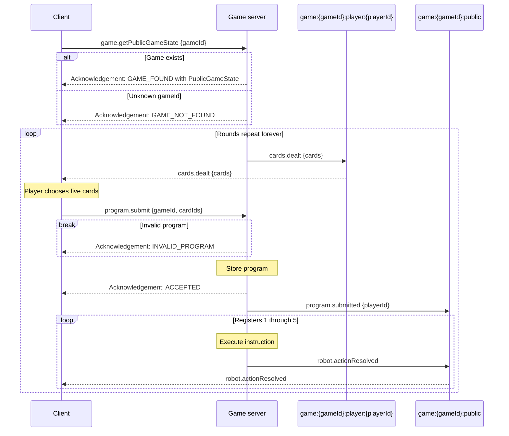

# Communication between components in v0

The communication contract between client and server is defined in `docs/asyncapi.yaml`. A rendered version can be found in `docs/asyncapi.html`.

Additionally, I want to give some context of how this communication works in v0:

For v0 we have decided to only model:
- sending the initial game state to the client
- in a never ending repeated loop:
    1. deal a hand of cards to the player
    2. accept a program of 5 cards from a player
    3. Loop over the card's server side, executing them one by one and sending the results/changes in robot board position back after each execution

The below sequence diagram highlights this flow if information. Additionally, to the client and game server I added the socketIo rooms as objects to make the flow of information clear. 

## Client and Game Service coordination

The client uses the shared types in `@robo-rally/game-events`. For the
single-player service in #40, configure the client with the service's game UUID
(`VITE_GAME_ID`) and origin (`VITE_GAME_SERVICE_URL`).

The connection flow uses the existing acknowledgement contract, not a new
state-push event:

1. On connection, the client requests `game.getPublicGameState`.
2. The service acknowledges with `GAME_FOUND` and the board, robots, and phase, or
   `GAME_NOT_FOUND`. It sends the player's nine cards through `cards.dealt`.
3. The client submits five distinct card IDs in register order through
   `program.submit`. `INVALID_PROGRAM` preserves the selection for retry.
   `ACCEPTED` locks submission until the next hand.
4. The service sends `program.submitted`, then one `robot.actionResolved`
   event per register, in order.
5. After register five, the service returns to `PROGRAMMING` before sending
   `cards.dealt`. On each deal, the client requests public state again so it can
   display the authoritative phase.

The client clears registers on each deal but does not replace the robot
playback queue with the final snapshot. Every resolved position and orientation
is displayed before the next hand becomes editable. This also applies with
reduced motion enabled; the existing renderer owns animation timing.

The board is fixed for this single-player loop. Snapshots initialize its robot
positions; subsequent movement comes from resolved-action events. Full
resynchronization and replay remain in #13. A five-second acknowledgement
timeout keeps the selected program locked because the client cannot know
whether the service accepted it. It does not retry automatically.

