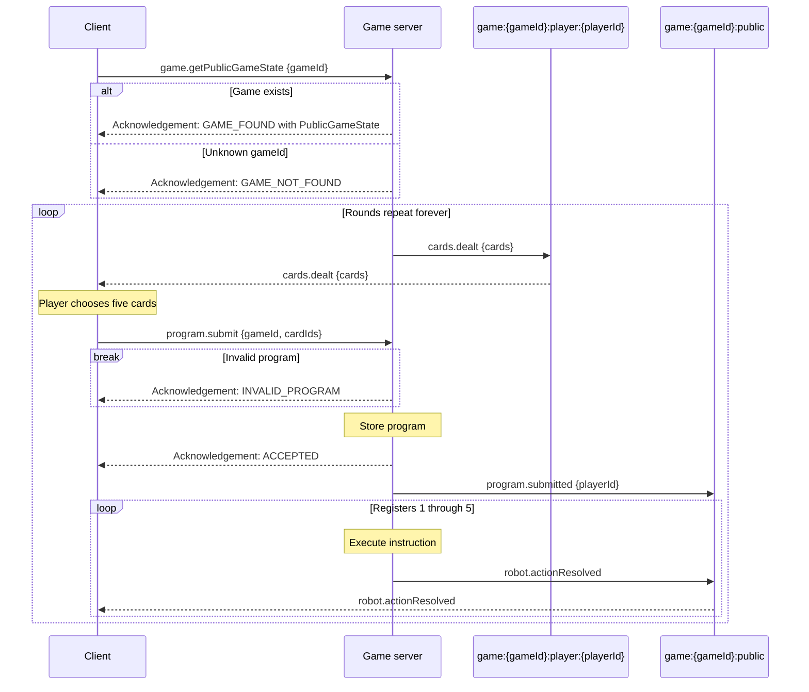

# Communication between components in v0

The communication contract between client and server is defined in `docs/asyncapi.yaml`. A rendered version can be found in `docs/asyncapi.html`.

Additionally, I want to give some context of how this communication works in v0:

For v0 we have decided to only model:
- sending the initial game state to the client
- in a never ending repeated loop:
    1. deal a hand of cards to the player
    2. accept a program of 5 cards from a player
    3. Loop over the card's server side, executing them one by one and sending the results/changes in robot board position back after each execution

The below sequence diagram highlights this flow if information. Additionally, to the client and game server I added the socketIo rooms as objects to make the flow of information clear. 

## Client and Game Service coordination

The client uses the shared types in `@robo-rally/game-events`. Configure its game
UUID with `VITE_GAME_ID` and service origin with `VITE_GAME_SERVICE_URL`.

1. On connection, the client requests `game.getPublicGameState`. The service sends
   the initial hand through `cards.dealt`; it may arrive before the state response.
2. The service acknowledges with `GAME_FOUND` and the board, robots, and phase, or
   `GAME_NOT_FOUND`. The hand stays locked until the initial state loads.
3. The client submits five distinct card IDs in register order through
   `program.submit`. `INVALID_PROGRAM` preserves the selection for retry;
   `ACCEPTED` locks submission until the next hand.
4. The service sends `program.submitted` to other clients and broadcasts one
   `robot.actionResolved` event per register, in order.
5. After register five, the service returns to programming and sends `cards.dealt`.
   The client clears its registers and keeps controls locked until playback
   finishes. It does not request another state snapshot.

Every resolved position and orientation is displayed in order, including with
reduced motion enabled. A five-second acknowledgement timeout keeps submission
locked because the outcome is unknown; the client does not retry automatically.

The board is fixed for v0. Robot positions are initialized from the first snapshot
and subsequently updated through resolved-action events. Reconnection,
synchronization, and replay remain outside this change (#13).
