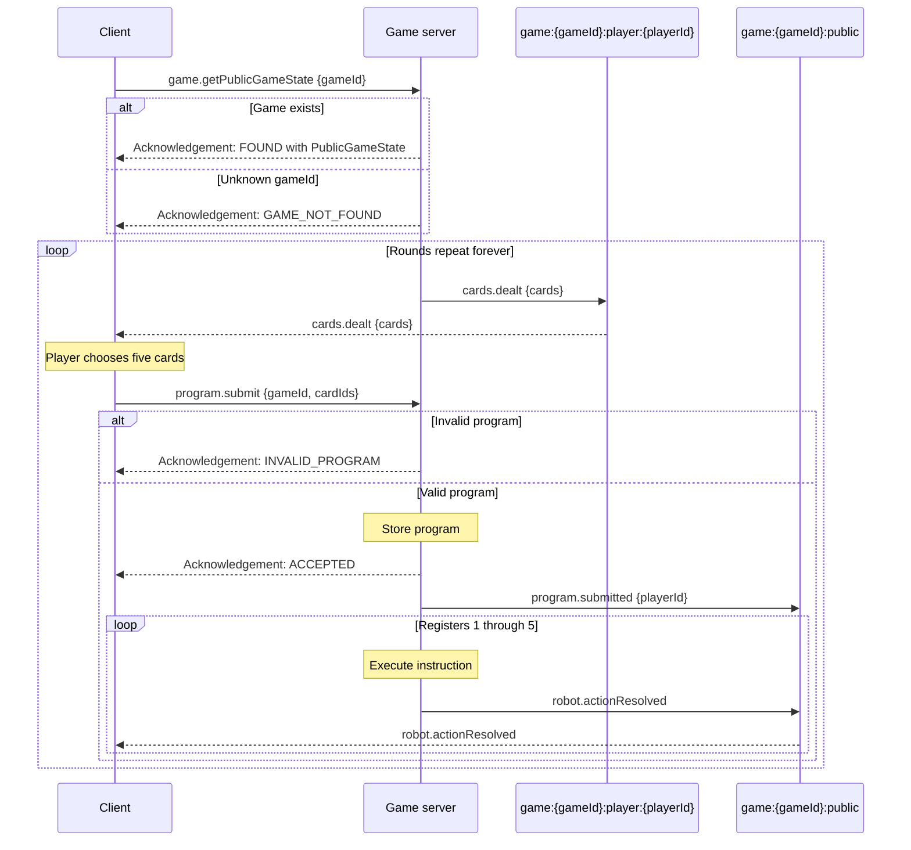

# Communication between components in v0

The communication contract between client and server is defined in `docs/asyncapi.yaml`. A rendered version can be found in `docs/asyncapi.html`.

Additionally, I want to give some context of how this communication works in v0:

For v0 we have decided to only model:
- sending the initial game state to the client
- in a never ending repeated loop:
    1. deal a hand of cards to the player
    2. accept a program of 5 cards from a player
    3. Loop over the card's server side, executing them one by one and sending the results/changes in robot board position back after each execution

The below sequence diagram highlights this flow if information. Additionally, to the client and game server I added the socketIo rooms as objects to make the flow of information clear. 

