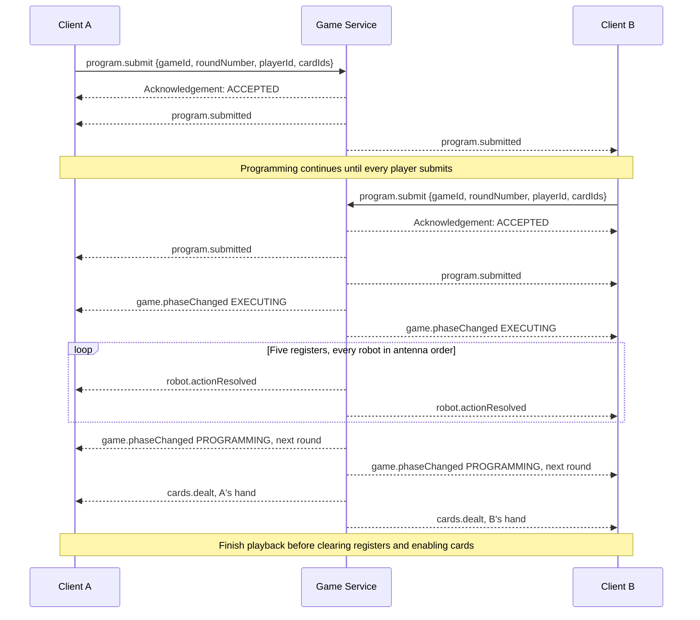

# Communication between the client and Game Service

The implemented event contract is in [AsyncAPI](asyncapi.yaml), with a
[rendered reference](asyncapi.html). Multiplayer rounds use the phase and round
fields proposed in [PR #76](https://github.com/hananinas/RoboRally/pull/76).
Login, joining, and membership changes remain in their separate issues.

## Round flow

The service accepts a fixed roster. It waits for every player to submit, with no
programming timer. Each robot acts once per register, in recalculated antenna
order. Game advances through five registers and then starts the next round.

Every update includes `gameId` and `roundNumber`. Action results also include
`registerIndex`, from zero through four. Several robots share a register index.
Blocked moves still produce results. The service sends each result immediately
and yields between actions, without waiting for animation acknowledgements.

`program.submitted` shares readiness with all game connections, including the
submitter. It never changes another player's local submission state or starts
activation. Only `game.phaseChanged` announces activation or programming.

## Client initialization and playback

The client uses `@robo-rally/game-events`. Set `VITE_GAME_ID` to the game UUID and
`GAME_SERVICE_URL` to the Game Service origin for the Vite proxy.

1. On connection, request `game.getPublicGameState`. The current entry path sends
   the initial private hand through `cards.dealt`, which can arrive first.
2. Apply the snapshot's board, robots, round, and phase. Buffer the hand
   until its matching snapshot arrives. The private hand identifies the controlled
   player until the join assignment replaces this entry path in #66 and #69.
3. Submit five distinct card IDs in order, with the assigned player and round.
   `ACCEPTED` locks the program while other players submit. `INVALID_PROGRAM`
   preserves the selection for retry. The service checks the connection's assigned
   player, current round, hand, and Game's submission rules.
4. Queue every action in received order. Keep the selected registers visible until
   playback ends, even if the next programming phase and hand have already arrived.
5. Enable programming only with a matching private hand, the programming phase,
   and no remaining playback. Ignore stale rounds, other games, and other players'
   hands. Do not request another snapshot between rounds.

Reduced motion still preserves action order. After five seconds without a
submission acknowledgement, keep the program locked because its outcome is
unknown. Never resend automatically. Reconnection and replay remain in #13.

## Fixed-roster integration hooks

`createGameSocketServer(httpServer, session)` accepts a `GameSession` containing
`gameId`, `game`, and `playerForConnection(socket)`. The resolver supplies an
existing Player from trusted service-side assignment. The service rejects a
missing assignment or a Player outside the roster. It never uses a submitted
player ID to grant control. Tests inject independent assignments through this
resolver. Default startup still uses the existing one-player development game;
this issue does not introduce a second login or join mechanism.

The interfaces for the related issues are:

- **#68, submissions:** resolve cards from the assigned player's hand and call
  `Game.submitProgram(playerId, cards)`. Acknowledge before shared readiness and
  phase events. `Game.hasSubmittedProgram(playerId)` exposes readiness without
  exposing cards. The required player/round fields and stale-round check are
  already implemented so a delayed previous-round request cannot start a new round.
- **#69, membership:** Game's roster is fixed here. Membership code must update
  eligibility and invoke `Game.recheckProgrammingPhase()` after programming-time
  removals. Publish membership changes before calling the service's shared
  `advanceGame()` path. That path publishes phase changes and schedules one
  `Game.executeNextAction()` at a time, leaving an event-loop boundary between
  actions. Activation-time participation and early completion on removal belong
  to the membership implementation and must follow #63's contract.
- **#70, model:** Game owns the round, barrier, antenna priority, register advance,
  and next hands. Board owns positions. Player owns its hand and robot. Robot
  owns its program and direction. Connection and user identity stay in the service.

The existing fixed-deck behavior remains: every player receives the supplied
card supply each round, without drawing or shuffling. Per-player decks and card
rules are not changed by multiplayer progression.
